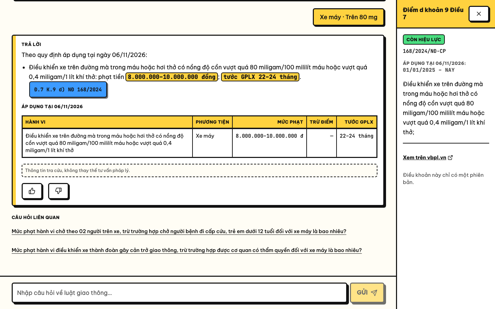

# LuậtGT

Thu thập văn bản luật giao thông từ vbpl.vn, dựng dữ liệu có phiên bản theo thời gian hiệu lực, và hỏi đáp có trích dẫn Điều/Khoản/Điểm.



| Tài liệu | Nội dung |
|---|---|
| [LuatGT_System_Design.md](LuatGT_System_Design.md) | Thiết kế hệ thống (spec v1.1) |
| [docs/DECISIONS.md](docs/DECISIONS.md) | Các quyết định và điểm lệch so với spec (D-001 … D-030) |
| [docs/THUYET_TRINH.md](docs/THUYET_TRINH.md) · [docs/PRESENTATION_EN.md](docs/PRESENTATION_EN.md) | Giải thích hệ thống, sơ đồ, ảnh minh hoạ, dàn ý thuyết trình (tiếng Việt · tiếng Anh) |
| [docs/SOURCE_NOTES.md](docs/SOURCE_NOTES.md) | Ghi chú cấu trúc trang vbpl.vn |

---

## 1. Yêu cầu

| Thành phần | Phiên bản | Dùng cho | Bắt buộc |
|---|---|---|---|
| Python | 3.11 trở lên | Toàn bộ backend và pipeline | Có |
| Docker (Docker Desktop) | Có `docker compose` | Postgres 16 + pgvector, MinIO | Có |
| Java (JDK) | **17 hoặc 21** | Spark 4 (bước parse và streaming) | Có |
| Node.js | **20.9 trở lên** | Giao diện web Next.js | Có, nếu chạy web |
| Máy có màn hình | | Crawler mở Chromium có giao diện vì vbpl.vn chặn trình duyệt chạy ẩn (D-007) | Có, nếu crawl |
| Dung lượng đĩa trống | Khoảng 8 GB | Model `BAAI/bge-m3` khoảng 4,5 GB, Chromium, image Docker | Có |
| Tesseract | | OCR cho PDF dạng scan | Không |

Hướng dẫn dưới đây viết cho macOS và Linux. Đã chạy thử trên macOS với Python 3.11.13, OpenJDK 17, Node 24, Docker 28.

Cài nhanh trên macOS bằng Homebrew (bỏ qua những gì đã có):

```bash
brew install python@3.11 openjdk@17 node
```

```bash
brew install --cask docker
```

```bash
brew install tesseract tesseract-lang
```

---

## 2. Cài đặt (làm một lần)

**Bước 1. Lấy mã nguồn và tạo file cấu hình**

```bash
git clone https://github.com/ThienDuong-1207/Luat.git
```

```bash
cd Luat && cp .env.example .env
```

Mở `.env` và sửa hai chỗ nếu cần:
- `JAVA_HOME`: bỏ dấu `#` và trỏ tới JDK 17 hoặc 21. Trên macOS xem đường dẫn bằng `/usr/libexec/java_home -V`.
- **Cổng Postgres:** nếu máy đã có Postgres khác (ví dụ Postgres.app) chiếm cổng 5432, đặt `POSTGRES_PORT=5434` và sửa cổng trong `POSTGRES_URL` thành `5434`. Xem mục 9.

**Bước 2. Bật Postgres và MinIO**

```bash
docker compose up -d
```

Đợi đến khi cả hai container báo `healthy`:

```bash
docker compose ps
```

**Bước 3. Môi trường Python cho pipeline và API**

```bash
python3.11 -m venv .venv
```

```bash
.venv/bin/pip install -e ".[all]"
```

```bash
.venv/bin/playwright install chromium
```

Extras có thể cài riêng nếu chỉ cần một phần: `crawler`, `parsing`, `spark`, `ml`, `api`, `dev`. `all` gồm tất cả.

**Bước 4. Tạo bảng và bucket, kiểm tra kết nối**

```bash
.venv/bin/luatgt db migrate
```

```bash
.venv/bin/luatgt storage init
```

```bash
.venv/bin/luatgt health
```

Kết quả đúng là `postgres: ok` và `minio: ok`. Hai lệnh đầu chạy lại nhiều lần vẫn an toàn.

**Bước 5. Thư viện cho giao diện web**

```bash
npm --prefix web ci
```

---

## 3. Dựng dữ liệu từ đầu

Repo **không chứa dữ liệu luật đã xử lý** (thư mục `data/`, Postgres và MinIO đều trống sau khi clone). Chạy lần lượt bốn bước dưới đây; mỗi bước chạy lại vẫn an toàn.

| Bước | Lệnh | Làm gì | Thời gian ước tính |
|---|---|---|---|
| 1 | `.venv/bin/luatgt crawl --mode seed` | Mở Chromium, tải 9 văn bản trong `config/seed_documents.yaml` về Bronze (MinIO) và Postgres | 5–10 phút (giãn cách 3–6 giây mỗi trang) |
| 2 | `.venv/bin/luatgt reparse --all` | Bronze → Silver: tách Chương, Điều, Khoản, Điểm bằng Spark | Dưới 1 phút |
| 3 | `.venv/bin/luatgt build-gold` | Silver → Gold: áp sửa đổi, tạo phiên bản, trích mức phạt, kiểm tra chất lượng, nạp Postgres | Dưới 1 phút |
| 4 | `.venv/bin/luatgt build-index` | Tạo chỉ mục tìm kiếm; lần đầu tải model `BAAI/bge-m3` khoảng 4,5 GB | Vài phút (lần sau chỉ embed phần thay đổi) |

```bash
.venv/bin/luatgt crawl --mode seed
```

```bash
.venv/bin/luatgt reparse --all
```

```bash
.venv/bin/luatgt build-gold
```

```bash
.venv/bin/luatgt build-index
```

Khi crawl, **cửa sổ Chromium sẽ tự mở**; đừng đóng nó. Nếu vbpl.vn chặn, lần chạy dừng lại với trạng thái `blocked` và không cố vượt; đợi một lúc rồi chạy lại.

Kết quả mong đợi sau bước 4: 9 văn bản, 4.651 điều khoản, 5.032 phiên bản, 906 dòng mức phạt, 3.545 đoạn tìm kiếm. Kiểm tra nhanh:

```bash
.venv/bin/luatgt provision 168-2024-ND-CP/D6/K3/Pm --as-of 2026-08-01
```

```bash
.venv/bin/luatgt search "Xe máy vượt đèn đỏ bị phạt bao nhiêu?" --as-of 2026-10-20
```

Lệnh đầu liệt kê hai phiên bản của Điểm m khoản 3 Điều 6 NĐ 168 và đánh dấu `▶` ở bản áp dụng tại 01/08/2026 (bản gốc); đổi sang `--as-of 2026-10-20` thì dấu `▶` chuyển sang bản đã sửa bởi NĐ 238/2026. Lệnh sau in các điều khoản tìm được kèm mức phạt.

---

## 4. Chạy ứng dụng

Mở hai cửa sổ terminal.

**API** (cổng 8000):

```bash
.venv/bin/uvicorn --factory luatgt.api.main:app_factory --port 8000
```

**Web** (cổng 3000):

```bash
npm --prefix web run dev
```

Mở http://localhost:3000 và thử hỏi "Uống rượu lái xe bị phạt bao nhiêu?". Lần hỏi đầu sau khi bật API mất thêm vài giây để nạp model.

| Địa chỉ | Nội dung |
|---|---|
| http://localhost:3000 | Hỏi đáp |
| http://localhost:3000/van-ban | Danh sách văn bản, lịch sử phiên bản |
| http://localhost:3000/dashboard | Thống kê câu hỏi, quarantine, lần chạy các job |
| http://localhost:8000/docs | Tài liệu API (Swagger) |
| http://localhost:9001 | MinIO console (đăng nhập bằng `MINIO_ACCESS_KEY` / `MINIO_SECRET_KEY` trong `.env`) |

Gọi API trực tiếp:

```bash
curl -X POST localhost:8000/api/ask -H 'Content-Type: application/json' -d '{"question": "uống rượu lái xe bị phạt bao nhiêu", "as_of_date": "2026-10-20"}'
```

Web gọi API qua `API_URL` (mặc định `http://localhost:8000`). Nếu API chạy ở chỗ khác, đặt biến này trước khi `npm run dev`.

---

## 5. Streaming và dashboard

Mỗi câu hỏi và mỗi lần bấm hài lòng / không hài lòng trên web tạo một event trong thư mục `events/`. Đếm event theo cửa sổ 10 phút bằng Spark Structured Streaming:

```bash
.venv/bin/luatgt stream --once
```

`--once` xử lý hết event hiện có rồi dừng; bỏ `--once` để chạy liên tục. Kết quả hiện ở `/dashboard` (chọn khoảng 24 giờ hoặc 7 ngày).

Thí nghiệm watermark 5 / 15 / 60 phút trên event giả lập, kết quả ghi vào `docs/M9_WATERMARK.md`:

```bash
.venv/bin/python eval/run_watermark_experiment.py
```

---

## 6. Airflow (tuỳ chọn)

Airflow 2.11 chạy trên máy, trong virtualenv riêng `.venv-airflow` vì ràng buộc phiên bản của Airflow xung đột với pipeline (D-024). Các DAG gọi CLI trong `.venv`.

Cài một lần:

```bash
python3.11 -m venv .venv-airflow
```

```bash
.venv-airflow/bin/pip install "apache-airflow==2.11.0" --constraint "https://raw.githubusercontent.com/apache/airflow/constraints-2.11.0/constraints-3.11.txt"
```

Chạy (luôn qua `scripts/airflow.sh`, script này đặt `AIRFLOW_HOME`, thư mục DAG và các bản vá cho macOS):

```bash
scripts/airflow.sh standalone
```

Mở http://localhost:8080, đăng nhập `admin`, mật khẩu nằm trong `.airflow/standalone_admin_password.txt`.

| DAG | Lịch | Việc |
|---|---|---|
| `dag_crawl_daily` | 02:00 hằng ngày | Crawl; thành công thì kích hoạt `dag_build` |
| `dag_build` | Khi Bronze có dữ liệu mới | `reparse` → `build-gold` → `build-index` |
| `dag_recheck_weekly` | Chủ nhật 03:00 | Đánh dấu kiểm tra lại văn bản còn hiệu lực |
| `dag_stream` | Mỗi 10 phút | `luatgt stream --once` |
| `dag_eval` | Chạy tay | Đánh giá, ghi báo cáo |

---

## 7. Kiểm thử và đánh giá

```bash
.venv/bin/pytest -m "not integration"
```

```bash
.venv/bin/pytest
```

Lệnh đầu chạy các test không cần dịch vụ ngoài. Lệnh sau chạy đủ, gồm test `integration` cần Postgres và MinIO đang bật; các test này dùng database riêng `luatgt_test` và bucket `test-*`, không đụng dữ liệu thật.

Đánh giá hỏi đáp trên `eval/questions.yaml`, xuất `eval/reports/report.md` (tách tập dev/test, có thẻ tái lập và chỉ số theo nhóm):

```bash
.venv/bin/python eval/run_eval.py
```

Chụp lại ảnh minh hoạ cho tài liệu thuyết trình (cần API và web đang chạy):

```bash
.venv/bin/python scripts/take_screenshots.py docs/images
```

Kiểm tra code:

```bash
.venv/bin/ruff check .
```

```bash
npm --prefix web run lint
```

---

## 8. Bật LLM (tuỳ chọn)

Mặc định `LLM_API_KEY` để trống: câu trả lời được ghép từ mẫu có sẵn, số liệu lấy từ bảng `violations`. Muốn LLM viết lại câu văn cho tự nhiên, đặt trong `.env`:

```
LLM_PROVIDER=anthropic
LLM_API_KEY=<khoá API của bạn>
```

Số tiền và trích dẫn vẫn được kiểm tra lại với bảng; sai thì quay về mẫu có sẵn. Chế độ này mới thử với client giả (D-021). Không commit file `.env`.

---

## 9. Xử lý sự cố

| Hiện tượng | Nguyên nhân | Cách xử lý |
|---|---|---|
| `role "luatgt" does not exist` | Một Postgres khác trên máy (ví dụ Postgres.app) đang chiếm cổng trong `POSTGRES_URL` | Tắt Postgres kia, hoặc đặt `POSTGRES_PORT=5434` và sửa `POSTGRES_URL` sang `5434`, rồi `docker compose up -d` |
| `Cannot connect to the Docker daemon` | Docker Desktop chưa chạy | Mở Docker Desktop (`open -a Docker` trên macOS), đợi vài giây |
| Crawl dừng với `blocked` | vbpl.vn chặn truy cập | Không vượt chống bot; đợi rồi chạy lại. Crawler phải chạy trên máy có màn hình |
| Spark báo lỗi Java | Thiếu JDK hoặc sai phiên bản | Cài JDK 17 hoặc 21, đặt `JAVA_HOME` trong `.env` |
| `build-index` hoặc lần hỏi đầu rất lâu | Đang tải model bge-m3 (khoảng 4,5 GB) | Đợi tải xong; chỉ xảy ra lần đầu |
| Web hiện "Chưa kết nối được máy chủ" | API chưa chạy hoặc sai `API_URL` | Bật API ở cổng 8000 |
| Console web báo hydration mismatch có `bis_skin_checked` | Tiện ích Bitdefender trong trình duyệt gắn thêm thuộc tính | Tắt tiện ích cho `localhost` hoặc dùng cửa sổ ẩn danh; không ảnh hưởng chức năng |
| Airflow crash ngay khi chạy trên macOS | Thư viện `setproctitle` lỗi khi fork | Luôn chạy qua `scripts/airflow.sh`, script đã nạp bản vá |

---

## 10. Lệnh CLI

| Lệnh | Việc |
|---|---|
| `luatgt db migrate` | Tạo hoặc cập nhật bảng |
| `luatgt storage init` | Tạo bucket `bronze`, `silver`, `gold` |
| `luatgt health` | Kiểm tra kết nối Postgres và MinIO |
| `luatgt crawl --mode seed` | Crawl seed list; `--stage detail` hoặc `--stage download` để chạy một tầng |
| `luatgt crawl --save-fixtures tests/fixtures/vbpl/ --url <URL>` | Lưu HTML mọi tab của một trang để làm fixture |
| `luatgt recheck` | Đánh dấu văn bản còn hiệu lực để crawl lại |
| `luatgt reparse [--all \| --vbpl-id <id>]` | Bronze → Silver |
| `luatgt build-gold` | Silver → Gold, nạp Postgres |
| `luatgt build-index` | Tạo chỉ mục tìm kiếm |
| `luatgt search "<câu hỏi>" --as-of <ngày>` | Tìm kiếm kết hợp |
| `luatgt provision <khoá> --as-of <ngày>` | Nguyên văn một điều khoản tại một ngày |
| `luatgt stream [--once]` | Đếm event bằng Spark Streaming |

Thêm `--help` sau mỗi lệnh để xem đủ tuỳ chọn.

---

## 11. Cấu trúc thư mục

```
config/            settings.yaml, seed list, selector vbpl.vn, cấu hình câu hỏi phụ
src/luatgt/        crawler, parsing, modeling, quality, jobs (Spark), retrieval, qa, streaming, api
db/migrations/     SQL tạo bảng
dags/              Airflow DAG
web/               Next.js (trang hỏi đáp, văn bản, dashboard)
eval/              bộ câu hỏi, script đánh giá và thí nghiệm watermark
tests/             pytest; fixtures HTML của vbpl.vn
scripts/           airflow.sh, chụp ảnh minh hoạ
docs/              quyết định, ghi chú nguồn, tài liệu thuyết trình, ảnh
```

---

## 12. Tiến độ

- [x] M0. Khởi tạo dự án
- [x] M1. Khảo sát nguồn và fixtures ([docs/SOURCE_NOTES.md](docs/SOURCE_NOTES.md))
- [x] M2. Crawler 3 tầng
- [x] M3. Parsing → Silver
- [x] M4. Sửa đổi + phiên bản (SCD2)
- [x] M5. Violations + quality ([docs/M5_SAMPLE_CHECK.md](docs/M5_SAMPLE_CHECK.md))
- [x] M6. Index + retrieval
- [x] M7. Câu hỏi phụ, trả lời, API
- [x] M8. Frontend
- [x] M9. Streaming + dashboard ([docs/M9_WATERMARK.md](docs/M9_WATERMARK.md))
- [x] M10. Airflow + đánh giá
- [ ] M11. Bổ sung theo giáo án: đã xong tách eval dev/test (D-026), `job_runs` và `run_id` cho quarantine (D-027); còn tập test do nhóm soạn, role DB quyền tối thiểu, bằng chứng Spark, lưu giữ event

Thông tin tra cứu, không thay thế tư vấn pháp lý.
