# LuậtGT: Vietnamese traffic law lookup with citations

Source document for the presentation (English version of `THUYET_TRINH.md`). Figures come from the run on 06/11/2026 and match spec v1.1 (`LuatGT_System_Design.md`).

**Presentation format from the reading list:**
- 12 minutes of presentation plus 3 minutes of Q&A; at most 8 content slides; every member speaks.
- Cite every claim borrowed from a source, and state which parts used AI assistance.

**Note on language:** the system works on Vietnamese legal text, so the screenshots, example questions and legal names stay in Vietnamese. Each one has an English translation next to it. Common abbreviations: **NĐ** = Decree (Nghị định), **Luật** = Law, **Đ.** = Article (Điều), **K.** = Clause (Khoản), **Điểm** = Point (lettered item), **GPLX** = driving licence.

---

## 1. The problem

A citizen asks an everyday question: *"Uống rượu lái xe bị phạt bao nhiêu?"* ("What is the fine for drink-driving?"). Answering it correctly is harder than it looks:

| Difficulty | Example |
|---|---|
| The law changes over time | Decree 168/2024/NĐ-CP was amended by Decree 238/2026/NĐ-CP from 15/08/2026 |
| One question has many answers | The fine depends on the vehicle type and the alcohol level |
| The rules are scattered | They live in laws, the penalty decree, implementing decrees and amending documents |
| Citizens and the law use different words | "vượt đèn đỏ" (running a red light) vs. "không chấp hành hiệu lệnh của đèn tín hiệu giao thông" (failing to obey the traffic signal) |
| Mistakes have real consequences | A generic chatbot can invent a fine amount |

**Driving question:** how do we answer quickly, correctly for the date in question, with verifiable sources, and without letting AI make up the numbers?

---

## 2. Proposed solution

A lookup system built on five ideas:

1. **Official source data:** collected from vbpl.vn, Vietnam's national database of legal documents.
2. **Versioned law:** every provision knows its own wording for each period of time.
3. **Numbers come from a table, not from AI:** fines are extracted in advance into a structured table.
4. **Ask back when information is missing:** instead of guessing, the system asks for the vehicle type or alcohol level.
5. **Always cite:** every answer links to the exact point, clause and article, and the original text can be opened.

Guiding principle: **AI finds the right place; the data decides the number.**

---

## 3. What the user sees

| Page | Purpose |
|---|---|
| `/` Q&A | Ask in natural language, pick the applicable date, answer follow-up questions, open the original text |
| `/van-ban` (Documents) | List of documents, filtered by legal status |
| `/van-ban/[id]` | Table of contents, text at a given date, amendment relations, version history |
| `/dashboard` | Questions by topic, negative feedback, data waiting for review, latest run of each job |

Layout of the Q&A page on wide screens (1280px and up):
- **Left 80%:** the Q&A area.
- **Right 20%:** the **legal reference column**. Clicking a citation chip (a blue box such as `Đ.7 K.9 d) NĐ 168/2024`) shows the provision's original text here, without covering the answer.
- On small screens and phones the original text opens in a slide-up panel.

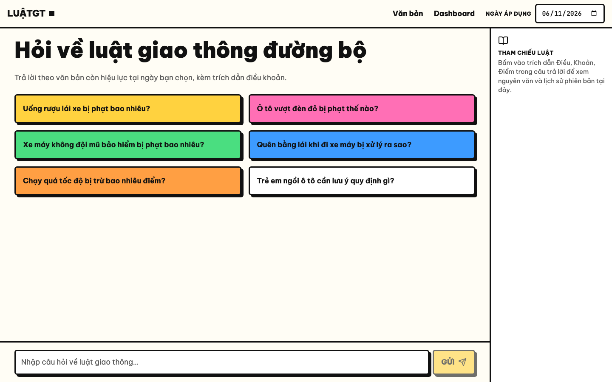
*Figure 1. Q&A page: asking on the left 80%, legal reference column on the right, applicable-date picker at the top.*

Inside an answer:
- **Penalties** (fine amounts, licence points, licence suspension) are highlighted in **yellow** with a black border.
- **Citation chips** stay **blue**; clicking one opens the original text.
- **Follow-up questions** are radio choices: pick everything, then press **Xem mức phạt** ("See the fine") once.

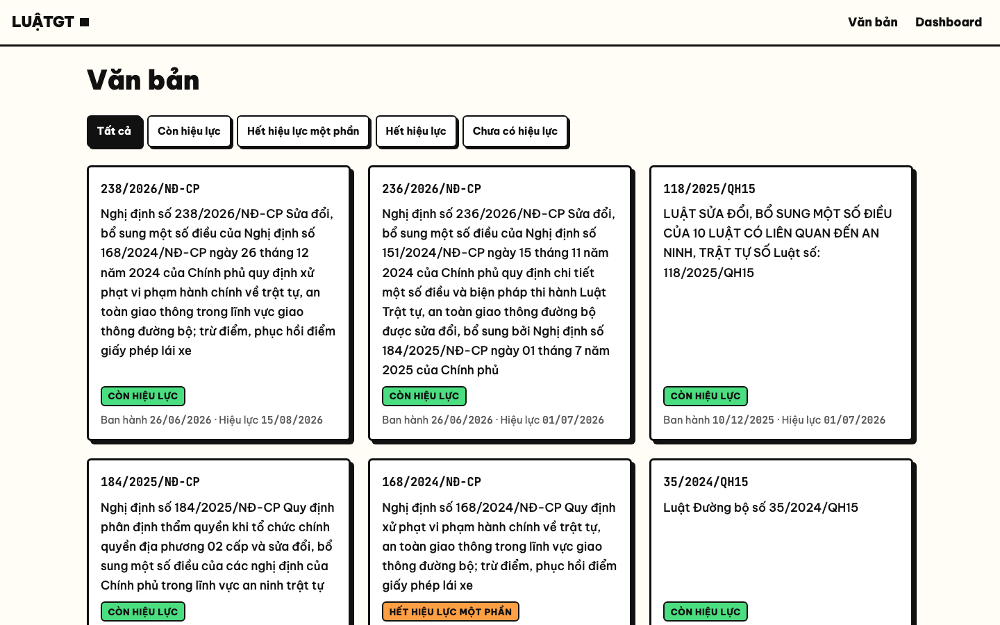
*Figure 2. Documents page: the 9 documents in the corpus, each with a legal-status badge taken from vbpl.vn.*

### Demo script (about 2 minutes)

| Step | Action | Result | What it proves |
|---|---|---|---|
| 1 | Ask *"Uống rượu lái xe bị phạt bao nhiêu?"* (drink-driving fine?) | No answer yet; two questions appear: vehicle type and alcohol level | It does not guess when information is missing |
| 2 | Choose "Xe máy" (motorbike) and "Trên 80 mg" (over 80 mg), press See the fine | **8,000,000–10,000,000 VND; licence suspended 22–24 months** (highlighted) | The exact number for the exact situation |
| 3 | Click the chip `Đ.7 K.9 d) NĐ 168/2024` | The original text appears in the right column | Verifiable, with a source |
| 4 | Ask *"Chở hàng cồng kềnh"* (carrying bulky goods), with no word "fine" | Quotes Article 33 of Law 36/2024, then asks the vehicle type to give the "Related penalties" | Answers both the rule and the penalty |
| 5 | Set the date to 01/08/2026 and ask *"Chở trẻ em dưới 10 tuổi ngồi ghế trước ô tô bị phạt bao nhiêu?"* (child under 10 in the front seat of a car); then switch to 20/10/2026 and ask again | 01/08: chip `Đ.6 K.3 m) NĐ 168/2024`, still with the clause "not using a suitable child safety device". 20/10: the chip says "amended by NĐ 238/2026" and that clause is gone | Correct for the date |
| 6 | Ask *"Công thức làm bánh mì"* (bread recipe) | Reports "not found" | No made-up answers |

Screenshots for each step are in the sections below: steps 1–3 in 6.4 (Figures 8–10), step 4 in 6.3 (Figure 7), step 5 in 5.2 (Figures 3–4), step 6 in 6.2 (Figure 6). Figure 5 shows a short question (6.2) and Figure 11 the dashboard (7).

---

## 4. Architecture overview

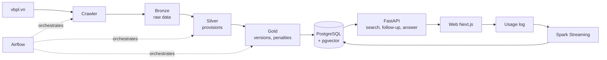

The system has two separate flows:

- **Data preparation flow (batch):** runs on a schedule and turns raw documents into data ready for lookup. Most of the system's "intelligence" lives here.
- **Answer flow (online):** for each question it only looks up the prepared data, which is why answers take about one second.

```mermaid
flowchart LR
    subgraph BATCH["Data preparation: scheduled, takes tens of seconds"]
        direction TB
        S1["1. Collect law pages"] --> S2["2. Split into Articles, Clauses, Points"]
        S2 --> S3["3. Apply amendments, record effective dates"]
        S3 --> S4["4. Extract fines into a table"]
        S4 --> S5["5. Quality checks"]
        S5 --> S6["6. Build the search index"]
    end
    subgraph ONLINE["Answering: per question, about 1 second"]
        direction TB
        Q1["Find relevant provisions"] --> Q2["Ask back if information is missing"]
        Q2 --> Q3["Take the fine from the table"]
        Q3 --> Q4["Assemble answer + citations"]
    end
    S6 ==>|"Prepared data store"| Q1
```

**Plain-language analogy:** think of a library. The batch flow is the librarian who reads every law book, cuts it into small entries, writes index cards and notes the effective dates. The answer flow is the reference desk: it only needs to find the right card, not reread the whole library.

| Component | Technology |
|---|---|
| Collection | Playwright (a real browser) |
| Data processing | PySpark |
| Storage | MinIO (raw files, Parquet), PostgreSQL + pgvector |
| Search | bge-m3 embedding model combined with keyword search |
| Backend | FastAPI |
| Frontend | Next.js, TypeScript, Tailwind |
| Streaming | Spark Structured Streaming |
| Orchestration | Apache Airflow |

---

## 5. How the data is collected and processed

Data moves through three layers, each "cleaner" than the one before. This layout is usually called the **medallion architecture** (Bronze, Silver, Gold).

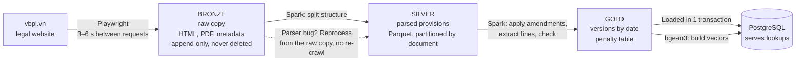

| Layer | Like | Stored in | If it breaks |
|---|---|---|---|
| Bronze | A photocopy of the law book | MinIO, bucket `bronze` | Must re-crawl; that is why it is never deleted |
| Silver | The book cut into Article, Clause and Point cards | MinIO, Parquet | Rebuilt from Bronze |
| Gold | Cards annotated with effective dates, plus the penalty table | MinIO, Parquet and PostgreSQL | Rebuilt from Silver |

### 5.1. The journey of one provision (real example)

Follow **Point d, Clause 9, Article 7 of Decree 168/2024/NĐ-CP**: motorbike, alcohol over 80 mg.

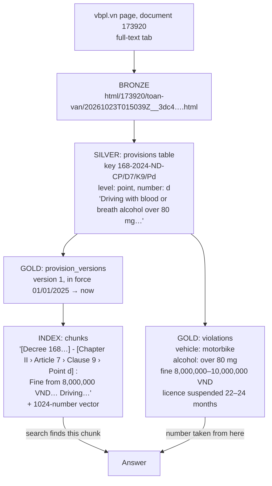

| Layer | What the data looks like | Produced by |
|---|---|---|
| **Source** | The vbpl.vn page of Decree 168/2024 (document id `173920`) | National legal documents database |
| **Bronze**: raw copy | HTML files of each tab (`toan-van` full text, `thuoc-tinh` attributes, `luoc-do` relations, `lich-su` history, `tai-ve` downloads) stored under `bronze/html/173920/...`; file names carry the crawl time and a content hash | Crawler, 23/10/2026 |
| **Silver**: provision | One row in `provisions`: key `168-2024-ND-CP/D7/K9/Pd`, level "point", number "d", text "Điều khiển xe trên đường mà trong máu hoặc hơi thở có nồng độ cồn vượt quá 80 miligam/100 mililít máu…" (driving with blood or breath alcohol over 80 mg/100 ml…). Lead-in of Clause 9: "Phạt tiền từ 8.000.000 đồng đến 10.000.000 đồng…" (fine from 8,000,000 to 10,000,000 VND…) | Structure parser (rules, no AI) |
| **Gold**: version | `provision_versions`: version 1, in force from 01/01/2025, never amended | Amendment step |
| **Gold**: penalty | `violations`: vehicle = motorbike, alcohol = over 80 mg, fine 8,000,000–10,000,000 VND, licence suspended 22–24 months | Penalty extraction (rules, no AI) |
| **Index** | `chunks`: "[Decree 168…] - [Chapter II > Section 1 > Article 7 … > Clause 9 > Point d] : Fine from 8,000,000 VND… Driving…", plus a 1024-number vector | bge-m3 model |

So when someone asks about a motorbike and alcohol over 80 mg, the system finds this chunk and takes the fine **from the `violations` table**; it does not read the text and guess.

### 5.2. The six preparation steps

**Step 1: Collect (vbpl.vn → Bronze).**
- Open pages in a real browser, waiting 3–6 seconds between requests.
- If blocked, stop the whole run; never bypass anti-bot protection.
- Keep the original pages forever. When the parser has a bug, reprocess from the raw copy instead of crawling again.

**Step 2: Parse structure (Bronze → Silver).**
- Recognise "Chương" (Chapter), "Điều 7." (Article 7), "9." (Clause 9), "d)" (Point d) with rules (regex) and build the tree Chapter › Section › Article › Clause › Point.
- Each unit gets a stable key, e.g. `168-2024-ND-CP/D7/K9/Pd`.
- Store as Parquet (columnar, compresses well, fast to read), partitioned by document.

**Step 3: Apply amendments and build versions (Silver → Gold).**
- Read instructions in the amending document, e.g. "Sửa đổi, bổ sung điểm m khoản 3 như sau:" ("Point m of Clause 3 is amended as follows:") in Decree 238/2026.
- Identify the affected provision and the effective date, then create a new version. This technique is **SCD Type 2** (slowly changing dimension).
- Real example, Point m, Clause 3, Article 6 of Decree 168 (carrying children in a car):

| Version | In force | Text (shortened) |
|---|---|---|
| 1 (Decree 168/2024) | 01/01/2025 → 15/08/2026 | Carrying a child under 10… in the same row as the driver **or not using a suitable child safety device** |
| 2 (Decree 238/2026) | 15/08/2026 → now | Carrying a child under 10… in the same row as the driver (the "safety device" clause is removed from this point) |

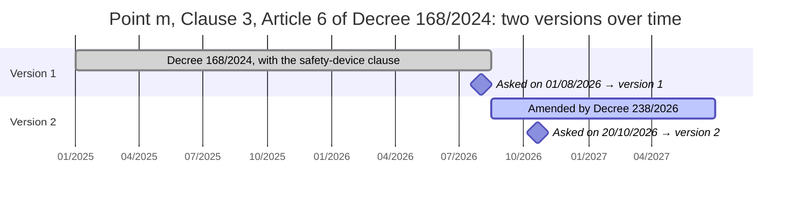

For a question at a given date, the system only uses versions where `valid_from ≤ date < valid_to`.

Real results for the same question, *"Chở trẻ em dưới 10 tuổi ngồi ghế trước ô tô bị phạt bao nhiêu?"* (fine for a child under 10 in a car's front seat), on two different dates:

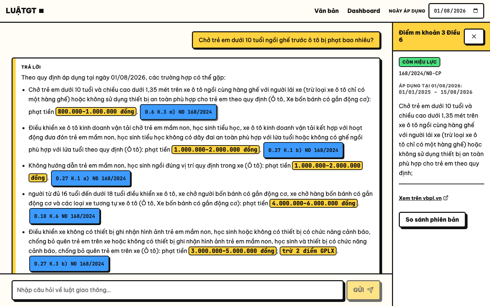
*Figure 3. Date 01/08/2026 (before Decree 238): Point m still contains "not using a suitable child safety device"; the right column shows it in force 01/01/2025 – 15/08/2026.*

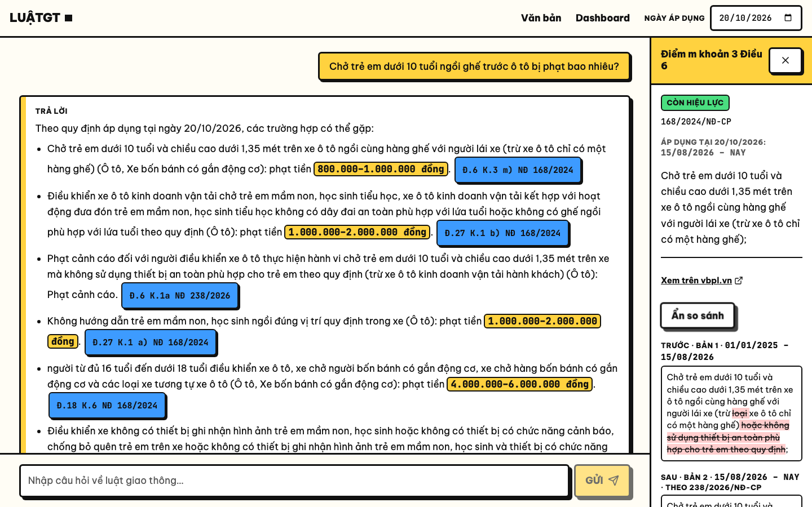
*Figure 4. Date 20/10/2026 (after Decree 238): that clause is struck through in red in the version comparison, and it moves to a new provision, Article 6 Clause 1a of Decree 238/2026, with a "warning" penalty (Phạt cảnh cáo).*

These two figures are the clearest evidence of "correct for the date": the same question on different dates gives different rules, and each rule points to the document that issued it. Across the corpus, 430 amendment instructions were applied automatically; 19 complex ones wait in a review queue.

**Step 4: Extract penalties.**
- Read the lead-in "Phạt tiền từ X đồng đến Y đồng đối với người điều khiển xe mô tô…" (fine from X to Y VND for motorbike riders…) and the points under it.
- Each behaviour becomes one structured row: behaviour, vehicle, alcohol level or speed, minimum and maximum fine, licence points, licence suspension, conditions.
- Rules, not AI, so the numbers are copied exactly from the text.

**Step 5: Quality checks.**
- Example rules: minimum fine ≤ maximum fine; two versions must not overlap in time; Article numbers must be continuous.
- Suspicious records go to **quarantine**; nothing is dropped silently. Each record carries the `run_id` of the run that produced it.
- Serious errors stop publishing. New data is loaded into Postgres in **a single transaction**; a failure midway rolls back, and the old data keeps serving.

**Step 6: Build the search index.**
- Each Point (or Clause or Article when there are no Points) becomes a chunk, prefixed with the document name, the table-of-contents path and the lead-in with the fine, so the chunk makes sense on its own.
- The bge-m3 model turns each chunk into a vector of 1024 numbers. Chunks with similar meaning have nearby vectors.

### 5.3. Data produced

| Item | Count |
|---|---|
| Documents | 9 |
| Provisions | 4,651 |
| Amendment instructions | 449 (430 applied automatically, 19 waiting for review) |
| Provision versions | 5,032 |
| Violation rows | 906 |
| Search chunks | 3,545 |
| Quarantine records | 31 |

Full rebuild time on a laptop: parsing 12.7 s, versions and penalties 8.1 s, indexing 15.7 s.

---

## 6. How the system answers a question

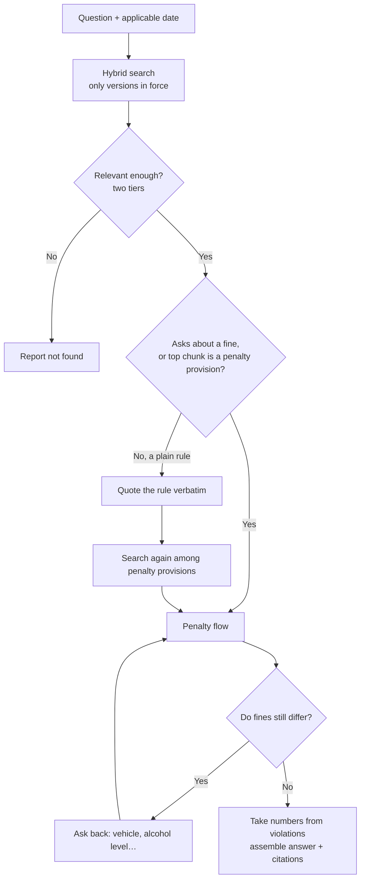

The same question, seen as messages between components:

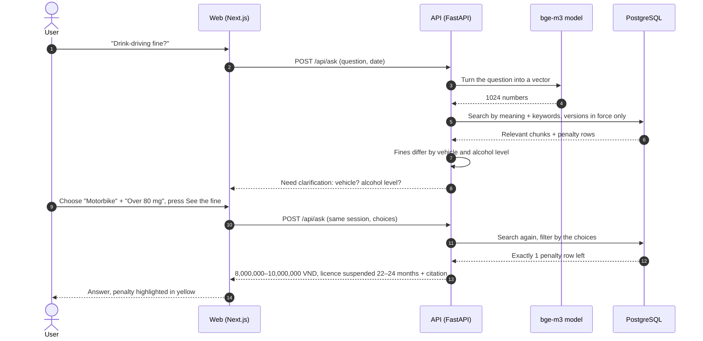

### 6.1. Step 1: Hybrid search
Two searches run in parallel, then the results are merged:

| Search | Good at | Example |
|---|---|---|
| **By meaning** (vectors, bge-m3) | Understands different wording | "uống bia" (drinking beer) ↔ "nồng độ cồn trong máu" (blood alcohol) |
| **By keyword** (full-text) | Exact terms and document numbers | "mũ bảo hiểm" (helmet), "168/2024" |
| **RRF merge** | Chunks ranked high by both rise to the top | |

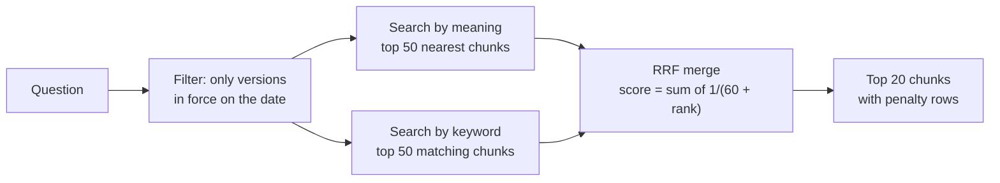

- The search only covers versions **in force on the applicable date**. Without this filter, a wrong-date version ranked above the correct one in 9 cases.
- Everyday words are expanded with legal wording, e.g. "vượt đèn đỏ" (running a red light) adds "không chấp hành hiệu lệnh của đèn tín hiệu" (failing to obey the traffic signal).

### 6.2. Step 2: Relevant enough? (two tiers)
Each result has a **similarity score** from 0 to 1. The system answers only if one tier holds:
1. Score ≥ **0.55**; or
2. Score ≥ **0.50** and **every word** of the question appears in the top chunk.

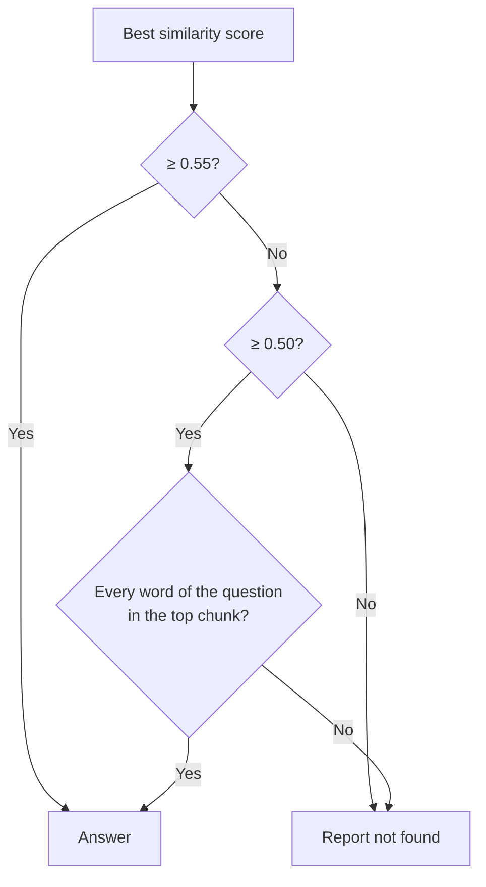

Tier 2 is for short, keyword-style questions: "không đội mũ bảo hiểm" (not wearing a helmet) scores only 0.541 but matches 4/4 words. Measured on 26 questions: 13/14 short traffic phrases are answered, and 0/12 off-topic questions are wrongly answered ("thời tiết hôm nay" — today's weather — scores only 0.49).

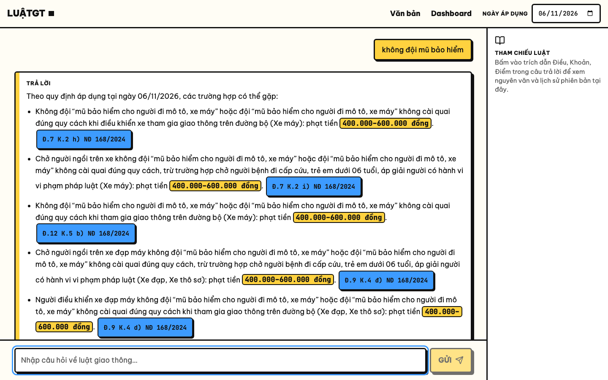
*Figure 5. The short question "không đội mũ bảo hiểm" (not wearing a helmet, score 0.541) is still answered thanks to tier 2; every fine is 400,000–600,000 VND, so no need to ask the vehicle type.*

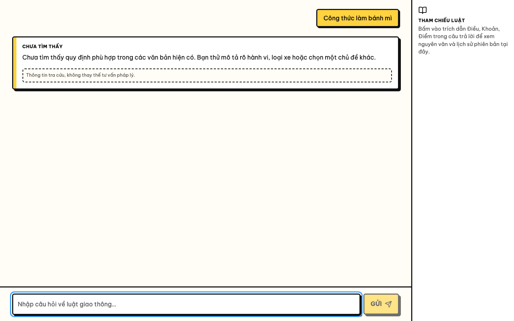
*Figure 6. Off-topic question "Công thức làm bánh mì" (bread recipe): the system reports not found instead of making something up.*

### 6.3. Step 3: Choosing how to answer

| Question | Top chunk | Answer style |
|---|---|---|
| Contains "phạt" (fine), "mức" (level), "xử lý" (handling)… | any | Give the penalty |
| No word "fine" | a penalty provision (e.g. "not wearing a helmet") | Give the penalty directly |
| No word "fine" | a plain rule (e.g. "carrying bulky goods" → Article 33, Law 36) | Quote the rule verbatim, then add "**Related penalties**" (Mức phạt liên quan) |

*Figure 7. "Chở hàng cồng kềnh" (carrying bulky goods) after choosing Motorbike: the top part quotes the rules of Law 36/2024 (blue chips), the bottom part "Mức phạt liên quan" (related penalties) comes from Decree 168/2024, with fines highlighted and a table.*

### 6.4. Step 4: How follow-up questions are generated
There is no scripted dialogue. The system looks at the candidate penalty rows:
- If they all have **the same fine**, it answers immediately. Example: "not wearing a helmet" is 400,000–600,000 VND for every vehicle type.
- If fines **differ by vehicle type** and the question names no vehicle, it always asks the vehicle type first. The options always include Motorbike, Car and Bicycle; choosing one that was not among the results makes the system search again for that vehicle.
- Other dimensions (alcohol level, speed…) are chosen by how much they narrow the fine range, measured with **entropy**: the dimension that splits the fines most clearly and with the largest gap wins.
- At most 3 rounds, at most 2 questions per round, always with an "Unknown" option. If several fines remain after the last round, the system lists all cases.

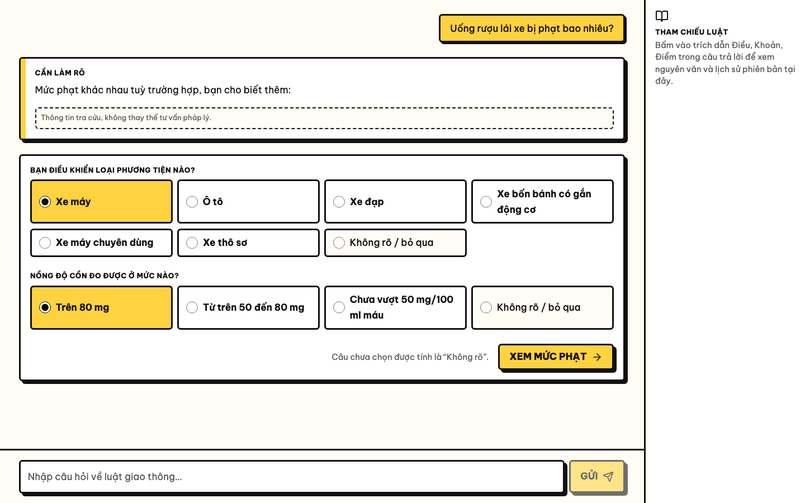
*Figure 8. Follow-up questions as radio choices: the system asks vehicle type and alcohol level at once; after choosing, press "Xem mức phạt" (See the fine) once.*

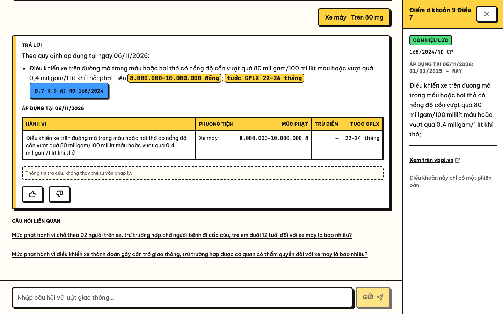
*Figure 9. Result after choosing Motorbike and Over 80 mg: exactly one penalty, 8,000,000–10,000,000 VND and licence suspended 22–24 months (highlighted); clicking the blue chip shows the original text in the right column.*

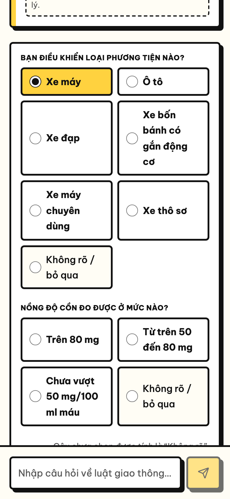
*Figure 10. On a phone: the choices form two columns, each large enough to tap.*

Example: "Drink-driving fine?" yields different fines by vehicle type (7 options) and alcohol level (3 levels), so the system asks both in one round. Choosing "Motorbike" and "Over 80 mg" leaves exactly one row.

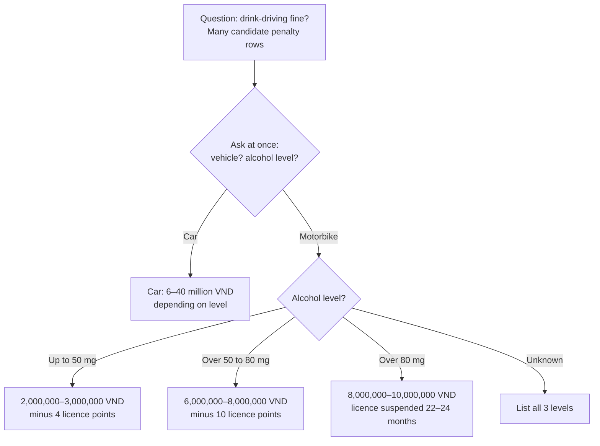

### 6.5. Step 5: Assembling the answer
- Numbers from the `violations` table are placed into a **fixed template**: "Under the rules in force on …: [behaviour]: fine [min]–[max] VND; licence suspended [x]–[y] months. [citation]".
- Plus a penalty table, citation chips that open the original text, and the line "for reference only, not legal advice".

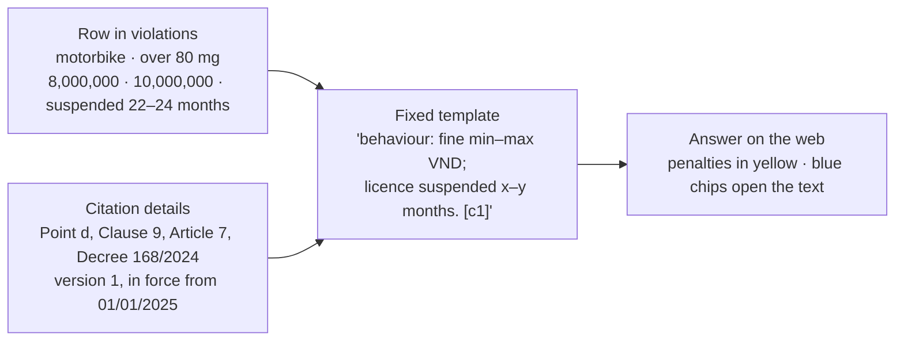

### 6.6. The role of AI: correct without an LLM?

| Task | Done by | AI? |
|---|---|---|
| Understanding the question to find provisions | bge-m3 embedding model running locally | **Yes**, a neural network |
| Choosing the version for the date | Data query | No |
| Giving the fine | `violations` table | No |
| Deciding whether to ask back | Entropy algorithm | No |
| Writing the answer | Fixed template; an LLM is optional | Not currently |

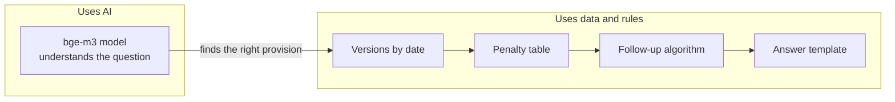

**One-line explanation for the talk:** "The system does use AI, but only for what AI does best: **understanding the question to find the right provision**. The numbers are not made up by AI; they were **copied from the legal text into a table** beforehand. AI finds the right place; the data decides the number."

Why it is correct without an LLM:
1. Legal text is very regular ("Phạt tiền từ X đồng đến Y đồng đối với…" — a fine from X to Y VND for…), so rules extract it accurately.
2. Every number traces back to a specific provision that can be opened and checked.
3. The validity filter picks the right version for the date; LLMs often do not know recent documents such as Decree 238/2026.
4. When information is missing, the system asks instead of guessing.

If the optional LLM is enabled, it only rewrites the sentences. Fine amounts and citations are checked against the table; on a mismatch it regenerates once, then falls back to the template. This mode has only been tested with a fake client, not the real API.

Limitation to state clearly: it is not always right. On 66 test questions (dev set), 83.3% of answers cite the correct provision. It is still weak on questions about general rules in the laws.

---

## 7. Usage analytics and operations

### Streaming

- Every question and feedback action produces an event; no user-identifying information is stored.
- Spark Structured Streaming counts events in 10-minute windows.
- The **watermark** decides how long to wait for late events. The **checkpoint** allows restarting after a failure. Writes are **upserts**, so reprocessing does not corrupt the counts.

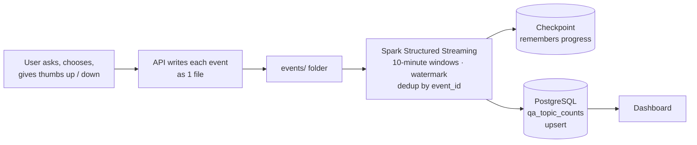

Experiment on 6,000 synthetic events, 8% of them late (a rate chosen for comparison):

| Watermark | Completeness | Rows dropped | Time to final count | Max state |
|---|---|---|---|---|
| 5 minutes | 93.62% | 402 | 6.8 min | 391 rows |
| 15 minutes | 97.25% | 173 | 16.8 min | 1,060 rows |
| 60 minutes (control) | 100% | 0 | 61.8 min | 4,089 rows |

**Takeaway:** waiting longer gives more complete counts, but results arrive later and use more memory. When Spark was forced to replay an already-written batch after a restart, not a single cell changed (0/108).

### Orchestration

Airflow schedules a daily crawl, a weekly status recheck, an automatic build after a successful crawl (via an Airflow Dataset), and a manually triggered evaluation.

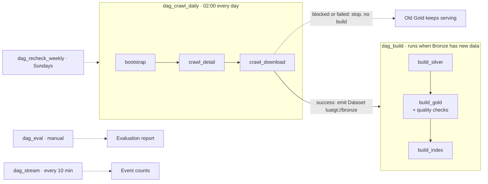

**Verification:** running everything from an empty database through Airflow produced the same row counts and hashes as the live data. This proves the pipeline is **reproducible**; it does not prove the data is legally correct.

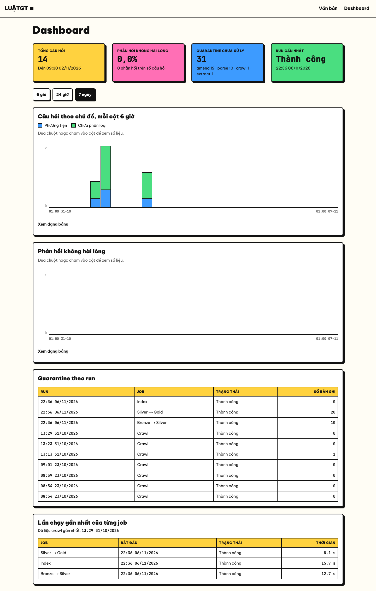
*Figure 11. Dashboard (7-day range): questions by topic computed by Spark Streaming, quarantine per run, and run time and data freshness of each job.*

**Operational observability:** every build run is recorded in the `job_runs` table with its status, run time and the latest crawl date of its input. The dashboard shows them. Run of 06/11/2026:

| Job | Time |
|---|---|
| Bronze → Silver | 12.7 s |
| Silver → Gold | 8.1 s |
| Indexing | 15.7 s |

**Getting "exactly-once" right:** the event source is at-least-once (events can be duplicated or late). The aggregates are correct exactly once thanks to the checkpoint, deduplication by `event_id` within the watermark, and idempotent upserts. We do not call this end-to-end exactly-once.

---

## 8. Evaluation results

> **Must be said during the talk:** these are **dev-set numbers**. These 66 questions were used to tune the search (synonym expansions, thresholds), so the numbers are optimistic. Following "never select a model on the test set" (P11), final results must be measured on a test set of new questions, written by a member who did not tune parameters, before running the system. **The test set does not exist yet.**

Measured on 66 dev questions; the expected answers are drafts not yet checked against the source by the team. Running `eval/run_eval.py` twice gives identical numbers, and the report includes a reproducibility card (commit, hashes of the question set and configs, data md5).

| Metric | Result |
|---|---|
| Recall@5 (hybrid + validity filter) | 87.9% |
| Recall@20 | 92.4% |
| Answers citing the correct provision | 83.3% |
| Correct citations out of all citations | 21.2% |
| Correct version | 95.0% (20 questions) |
| First line has the correct fine | 80.0% (60 questions with a fine) |
| Average follow-up rounds | 1.00 (14 questions asked back) |

Measured on 06/11/2026 after adding "always ask the vehicle type" and "related penalties" (D-029, D-030). Compared with before: correct citation 80.3% → 83.3%, correct version 90% → 95%; correct citations out of all citations dropped slightly, 22.6% → 21.2%, because answers now carry more citations.

Search configurations compared:

| Configuration | Recall@5 | Wrong-date version ranked first |
|---|---|---|
| Vector | 81.8% | 0 |
| Keyword | 77.3% | 0 |
| Hybrid, no validity filter | 84.8% | **9** |
| Hybrid + validity filter | 87.9% | **0** |

**Takeaway:** the validity filter completely removes cases where a wrong-date version ranks above the correct one.

Metrics by subgroup (P12; still dev numbers, small samples):

| Group | Recall@5 | Correct citation |
|---|---|---|
| All | 87.9% (58/66) | 83.3% (55/66) |
| Car | 89.7% (26/29) | 89.7% (26/29) |
| Motorbike | 90.5% (19/21) | 76.2% (16/21) |
| No vehicle mentioned | 78.6% (11/14) | 78.6% (11/14) |
| Answer in Decree 168/2024 | 93.3% (56/60) | 88.3% (53/60) |
| Answer in other laws and decrees | 2/6 | 2/6 |

**Takeaway:** the average hides weaknesses. The system does well on fines in Decree 168 but poorly on general rules in the laws; 4 of the 8 Recall@5 misses are in that group.

Caveats for the talk:

- Recall is optimistic because the synonym expansions were chosen after looking at the misses of this very set.
- The with/without follow-up experiment shows no measurable difference yet: "first line has the correct fine" is 80.0% for both; with follow-ups the answer is shorter (3.9 lines vs. 4.2). The "first line" metric is crude.
- Parsing accuracy and extraction accuracy have not been checked by hand.

---

## 9. Proposed improvements

By priority:

| Priority | Problem | Solution | Benefit |
|---|---|---|---|
| 1 | Missing amending documents: Decree 336/2025, Decree 319/2026, Law 143/2025 | Add them to the seed list and recheck legal status | Avoid answering with outdated rules |
| 2 | Only 21.2% of citations are correct; answers mix in similar behaviours | Add a re-ranking step and stricter candidate filtering | Shorter, more precise answers |
| 3 | No test set; the 66 dev answers are unchecked | Write ≥ 34 new test questions (dev/test split already supported), check by hand, add off-topic questions | Trustworthy numbers for the report |
| 3b | Weak on general rules in the laws (2/6) | Add dev questions for this group; review the chunks of Law 36/2024 and Law 35/2024 | Less dependence on one decree |
| 4 | Never declines hard questions: 66/66 were answered | Calibrate thresholds on an off-topic set; report confidence | Fewer confidently wrong answers |
| 5 | Does not ask for the violation date; no PDF page numbers | Add the `thoi_diem` (time) dimension; map Articles to PDF pages | Meets the full design |
| 6 | Template wording is dry | Enable the LLM with post-generation checks; test with the real API | More readable, at a cost |
| 7 | One file per event; Airflow in dev mode | Move to Kafka (key = `session_id`, `acks=all`, idempotent producer); production executor and database | Ready for higher traffic |
| 8 | Silver is just a Parquet folder with no transaction log | Move to Delta Lake when there are concurrent writers or time travel is needed; safe today because Airflow runs jobs sequentially | Atomic commits, consistent snapshots |
| 9 | The API shares the pipeline's database account | Least-privilege role: read-only on legal data, write only `qa_sessions` | Lower security risk |
| 10 | No Spark evidence yet (query plans, stages, caching, file-format comparison) | Save `explain` output, stage metrics, cache on/off and CSV/JSON/Parquet comparisons to `docs/evidence/` | Technical choices backed by measurements |

---

## 10. Presentation outline (12 minutes, 8 content slides)

The title slide and references slide do not count toward the 8 content slides. Timings are suggestions; fill in "Speaker" so every member presents at least one slide.

| Slide | Content | Diagrams and figures | Course concepts | Min | Speaker |
|---|---|---|---|---|---|
| 0 | Title, team members | | | 0.5 | |
| 1 | **Problem and driving question:** law changes over time, citizens use different words, mistakes have consequences | "Difficulty" table, section 1 | | 1 | |
| 2 | **Solution and short demo:** ask → asked back → cited answer → change the date | Figures 1, 8, 9 (or a live demo); sequence diagram, section 6 | | 2 | |
| 3 | **Architecture:** two flows (preparation / answering); why not Postgres only; why not Delta Lake yet | Two-flow and architecture diagrams, section 4; Figure 2 | P16; FDE Ch.3 | 1.5 | |
| 4 | **Data through Bronze → Silver → Gold:** following Point d, Clause 9, Article 7 of Decree 168 | Medallion and journey diagrams, section 5 | P07, P14; FDE Ch.6, Ch.8 | 1.5 | |
| 5 | **Versions by date and validity-filtered search:** the filter takes wrong-date-first from 9 to 0 | Timeline diagram, section 5.2; **Figures 3–4** (same question, two dates); search diagram, section 6.1 | FDE Ch.8, Ch.9 | 1.5 | |
| 6 | **Smart follow-ups and the role of AI:** why the numbers are right without an LLM | Narrowing diagram, section 6.4; Figures 7, 9; AI-role diagram, section 6.6 | | 1.5 | |
| 7 | **Streaming, operations and honest evaluation:** watermark, Airflow, dev numbers, subgroup weaknesses | Streaming and Airflow diagrams, section 7; Figure 11; tables, section 8 | P09–P12; NIST AI RMF | 1.5 | |
| 8 | **Limitations and next steps** | Table, section 9 | P14, P16 | 1 | |
| | References and AI-use statement | | | | |

**Figures** are in `docs/images/` (PNG, captured from the running system on 06/11/2026) and can go straight into slides. To recapture after UI changes: start the API and web, then run `.venv/bin/python scripts/take_screenshots.py docs/images`.

**Exporting diagrams for slides:** paste a `mermaid` block into [mermaid.live](https://mermaid.live) and download PNG or SVG. All diagrams in this file were test-rendered without errors.

Total about 12 minutes. To shorten, merge slide 5 into slide 4.

**AI-use statement (suggested):** the code, spec and this document were written with the help of Claude (Claude Code). The evaluation answers are AI-drafted and not yet checked by the team. Every number on the slides comes from real runs, with reports and reproducibility cards in the repository.

**Sources to cite on slides:**
- Reis & Housley, *Fundamentals of Data Engineering* (chapters noted per slide).
- Spark Structured Streaming Programming Guide: the reading list cites version 3.5.8 and the project runs Spark 4.2.0, so cite both.
- NIST AI RMF 1.0; NIST Privacy Framework.
- Delta Lake documentation (slides 3, 8); Kafka documentation (slide 6).
- Data source: vbpl.vn.

### Suggested closing line

The system does not try to be a chatbot that knows everything. It answers correctly for the date, shows its sources so users can check for themselves, and asks back when information is missing. It is a lookup tool, not a substitute for legal advice.

### Likely questions from the audience

| Question | Suggested answer |
|---|---|
| Why not just use ChatGPT? | A general model may not know recent amendments and may invent numbers; here numbers come from a table and are cited |
| Without an LLM, is it still AI? | Yes, search uses an embedding model; an LLM would only write the sentences |
| What if the data is wrong? | Suspicious records go to quarantine and users can open the original text; the eval answers and extraction sample still need manual checking by the team |
| Why streaming for the logs? | Logs can be late and duplicated, which is an event-time problem; legal documents change daily, so batch fits them |
| Does it collect personal data? | No user-identifying information is stored |
| Can we trust 87.9%? | It is a dev number, used for tuning, so it is optimistic; final results need a new test set, and the dev/test split is already in place |
| Is it "exactly-once"? | The source is at-least-once; aggregates are correct exactly once thanks to the checkpoint, dedup by `event_id` and idempotent upserts. Not end-to-end exactly-once |
| Why not HDFS? | Legal files are a few hundred KB, tiny compared with a 128 MB block, which creates a small-files problem for the NameNode; object storage fits better (P01) |
| Why not Delta Lake or Kafka yet? | No concurrent writers and low traffic so far; the switching conditions are written in spec 5.4 and 13.4 |
| The data is small; why call it big data? | It demonstrates the mechanisms (partitioning, versioning, streaming, reproducibility) and states the thresholds for changing the design; it makes no production-performance claims |
| What if the pipeline fails midway? | Every run is recorded in `job_runs`; Gold is loaded in one transaction, so it rolls back and the old data keeps serving |
| How can it be right without an LLM? | AI (bge-m3) only understands the question and finds provisions; the numbers were copied from the text into a table by rules beforehand, so nothing is invented, and each number traces back to a provision |
| What if users type very short questions? | Two-tier threshold: a short question is accepted if every word appears in the provision found; 13/14 short phrases answered, 0/12 off-topic questions wrongly accepted |
| What if the question names no vehicle? | If fines differ by vehicle type it always asks; if every vehicle has the same fine it answers directly |
| Does a question about a rule also get the fine? | Yes: it quotes the rule verbatim, then adds "Related penalties" |
