# LuậtGT: tra cứu luật giao thông có trích dẫn

Tài liệu nguồn cho bài thuyết trình. Số liệu lấy từ lần chạy ngày 06/11/2026, khớp với spec v1.1 (`LuatGT_System_Design.md`).

**Khung thuyết trình theo reading list:**
- 12 phút trình bày cộng 3 phút hỏi đáp; tối đa 8 slide nội dung; mọi thành viên đều nói.
- Ghi nguồn cho mọi nhận định mượn từ tài liệu, và ghi rõ phần nào có dùng AI hỗ trợ.

---

## 1. Vấn đề

Người dùng hỏi một câu rất đời thường: "Uống rượu lái xe bị phạt bao nhiêu?". Trả lời đúng câu này khó hơn vẻ ngoài vì:

| Khó khăn | Ví dụ |
|---|---|
| Luật thay đổi theo thời gian | NĐ 168/2024/NĐ-CP được NĐ 238/2026/NĐ-CP sửa đổi từ 15/08/2026 |
| Một câu hỏi có nhiều đáp án | Mức phạt phụ thuộc loại xe và nồng độ cồn |
| Nội dung nằm rải rác | Quy định nằm trong luật, nghị định xử phạt, nghị định hướng dẫn và văn bản sửa đổi |
| Người dùng và luật dùng từ khác nhau | "Vượt đèn đỏ" so với "không chấp hành hiệu lệnh của đèn tín hiệu giao thông" |
| Sai số trong lĩnh vực pháp lý có hậu quả thật | Chatbot thông thường có thể tự nghĩ ra mức phạt |

**Câu hỏi đặt ra:** làm sao để trả lời nhanh, đúng thời điểm, có căn cứ kiểm chứng được, và không để AI tự đặt ra con số?

---

## 2. Giải pháp đề xuất

Xây dựng một hệ thống tra cứu gồm năm ý chính:

1. **Lấy dữ liệu từ nguồn chính thức:** thu thập từ vbpl.vn, cơ sở dữ liệu quốc gia về văn bản pháp luật.
2. **Lưu luật theo phiên bản:** mỗi điều khoản biết rõ nội dung của mình tại từng khoảng thời gian.
3. **Số liệu lấy từ bảng, không lấy từ AI:** mức phạt được trích sẵn vào bảng dữ liệu có cấu trúc.
4. **Hỏi lại khi chưa đủ thông tin:** thay vì đoán, hệ thống hỏi loại xe, nồng độ cồn.
5. **Luôn có trích dẫn:** mỗi câu trả lời dẫn tới đúng điểm, khoản, điều và mở được nguyên văn.

Nguyên tắc xuyên suốt: **AI tìm đúng chỗ, dữ liệu quyết định con số.**

---

## 3. Người dùng thấy gì

| Trang | Chức năng |
|---|---|
| `/` Hỏi đáp | Hỏi bằng ngôn ngữ tự nhiên, chọn ngày áp dụng, trả lời câu hỏi phụ, mở nguyên văn |
| `/van-ban` | Danh sách văn bản, lọc theo tình trạng hiệu lực |
| `/van-ban/[id]` | Mục lục, nội dung tại một ngày, quan hệ sửa đổi, lịch sử phiên bản |
| `/dashboard` | Câu hỏi theo chủ đề, phản hồi không hài lòng, dữ liệu cần kiểm tra, lần chạy gần nhất của từng job |

Bố cục trang hỏi đáp trên màn hình rộng (từ 1280px):
- **80% bên trái** là phần hỏi đáp.
- **20% bên phải** là **cột tham chiếu luật**: bấm chip trích dẫn (ô xanh dương như `Đ.7 K.9 d) NĐ 168/2024`) thì nguyên văn điều khoản hiện ở đây, không che câu trả lời.
- Màn hình nhỏ và điện thoại: nguyên văn mở trong panel trượt lên.

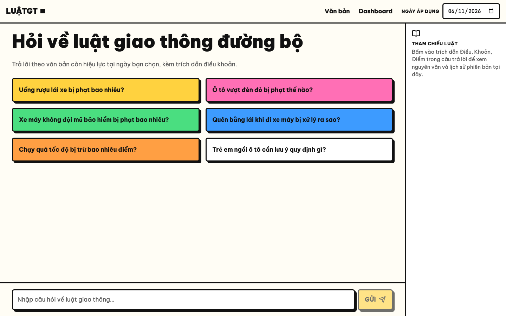
*Ảnh 1. Trang hỏi đáp: 80% bên trái để hỏi, cột tham chiếu luật bên phải, ô chọn ngày áp dụng ở góc trên*

Trong câu trả lời:
- **Mức phạt** (số tiền, trừ điểm, tước bằng) được tô **vàng** viền đen để nổi bật.
- **Chip trích dẫn** giữ màu **xanh dương**, bấm vào để mở nguyên văn.
- **Câu hỏi phụ** là các ô chọn (radio): chọn hết rồi bấm **Xem mức phạt** một lần.

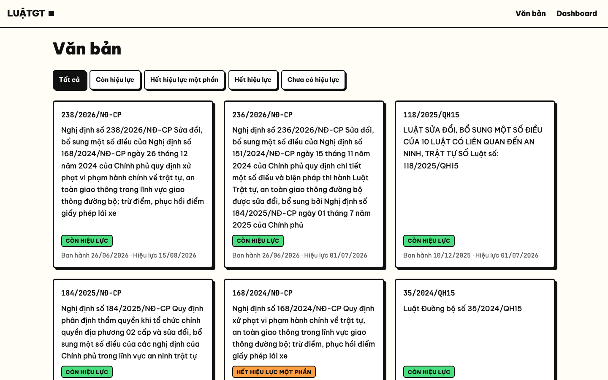
*Ảnh 2. Trang Văn bản: 9 văn bản trong kho, mỗi văn bản có badge tình trạng hiệu lực lấy từ vbpl.vn*

### Kịch bản demo (khoảng 2 phút)

| Bước | Thao tác | Kết quả | Điều muốn chứng minh |
|---|---|---|---|
| 1 | Hỏi "Uống rượu lái xe bị phạt bao nhiêu?" | Chưa trả lời ngay, hiện hai câu hỏi: loại xe và nồng độ cồn | Không đoán khi thiếu thông tin |
| 2 | Chọn "Xe máy" và "Trên 80 mg", bấm Xem mức phạt | **8.000.000–10.000.000 đồng; tước GPLX 22–24 tháng** (tô vàng) | Con số chính xác cho đúng tình huống |
| 3 | Bấm chip `Đ.7 K.9 d) NĐ 168/2024` | Nguyên văn hiện ở cột phải | Kiểm chứng được, có nguồn |
| 4 | Hỏi "Chở hàng cồng kềnh" (không có chữ "phạt") | Trích Điều 33 Luật 36/2024, rồi hỏi loại xe để đưa ra "Mức phạt liên quan" | Trả lời cả quy định lẫn mức phạt |
| 5 | Đặt ngày áp dụng 01/08/2026, hỏi "Chở trẻ em dưới 10 tuổi ngồi ghế trước ô tô bị phạt bao nhiêu?"; rồi đổi sang 20/10/2026 hỏi lại | Ngày 01/08: chip `Đ.6 K.3 m) NĐ 168/2024`, còn vế "không sử dụng thiết bị an toàn". Ngày 20/10: chip ghi "sửa đổi bởi NĐ 238/2026", vế đó đã bị bỏ | Đúng theo thời điểm |
| 6 | Hỏi "Công thức làm bánh mì" | Báo không tìm thấy | Không trả lời bừa |

Ảnh chụp của từng bước nằm ở các mục giải thích bên dưới: bước 1–3 ở mục 6.4 (Ảnh 8–10), bước 4 ở mục 6.3 (Ảnh 7), bước 5 ở mục 5.2 (Ảnh 3–4), bước 6 ở mục 6.2 (Ảnh 6). Ảnh 5 là câu ngắn ở mục 6.2, Ảnh 11 là dashboard ở mục 7.

---

## 4. Tổng quan kiến trúc

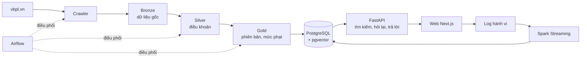

Hệ thống gồm hai luồng tách biệt:

- **Luồng chuẩn bị dữ liệu (batch):** chạy theo lịch, biến văn bản thô thành dữ liệu sẵn sàng tra cứu. Phần lớn "trí thông minh" của hệ thống nằm ở đây.
- **Luồng trả lời (online):** khi có câu hỏi, chỉ tra cứu dữ liệu đã chuẩn bị. Vì vậy trả lời trong khoảng một giây.

```mermaid
flowchart LR
    subgraph BATCH["Luồng chuẩn bị dữ liệu: chạy theo lịch, mất vài chục giây"]
        direction TB
        S1["1. Thu thập trang luật"] --> S2["2. Cắt thành Điều, Khoản, Điểm"]
        S2 --> S3["3. Áp sửa đổi, ghi ngày hiệu lực"]
        S3 --> S4["4. Trích mức phạt vào bảng"]
        S4 --> S5["5. Kiểm tra chất lượng"]
        S5 --> S6["6. Tạo chỉ mục tìm kiếm"]
    end
    subgraph ONLINE["Luồng trả lời: mỗi câu hỏi, khoảng 1 giây"]
        direction TB
        Q1["Tìm điều khoản liên quan"] --> Q2["Hỏi lại nếu thiếu thông tin"]
        Q2 --> Q3["Lấy mức phạt từ bảng"]
        Q3 --> Q4["Ghép câu trả lời + trích dẫn"]
    end
    S6 ==>|"Kho dữ liệu đã sẵn sàng"| Q1
```

**Cách nói dễ hiểu:** giống một thư viện. Luồng batch là thủ thư đọc từng cuốn luật, cắt thành từng mục nhỏ, ghi phiếu mục lục và ghi chú ngày hiệu lực. Luồng trả lời là quầy tra cứu: chỉ cần tìm đúng phiếu, không phải đọc lại cả thư viện.

| Thành phần | Công nghệ |
|---|---|
| Thu thập | Playwright (trình duyệt thật) |
| Xử lý dữ liệu | PySpark |
| Lưu trữ | MinIO (file gốc, Parquet), PostgreSQL + pgvector |
| Tìm kiếm | Model embedding bge-m3 kết hợp tìm từ khoá |
| Backend | FastAPI |
| Frontend | Next.js, TypeScript, Tailwind |
| Streaming | Spark Structured Streaming |
| Điều phối | Apache Airflow |

---

## 5. Dữ liệu được lấy và xử lý thế nào

Dữ liệu đi qua ba tầng, mỗi tầng "sạch" hơn tầng trước. Cách chia này thường gọi là **kiến trúc medallion** (Bronze, Silver, Gold).

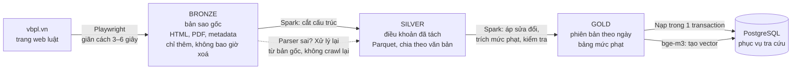

| Tầng | Giống như | Lưu ở đâu | Nếu hỏng thì |
|---|---|---|---|
| Bronze | Bản photo nguyên văn của cuốn luật | MinIO, bucket `bronze` | Phải crawl lại; vì vậy không bao giờ xoá |
| Silver | Cuốn luật đã cắt thành từng phiếu Điều, Khoản, Điểm | MinIO, Parquet | Dựng lại từ Bronze |
| Gold | Phiếu đã ghi ngày hiệu lực và bảng mức phạt | MinIO, Parquet và PostgreSQL | Dựng lại từ Silver |

### 5.1. Hành trình của một điều khoản (ví dụ thật)

Theo chân **Điểm d khoản 9 Điều 7 NĐ 168/2024/NĐ-CP**: xe máy, nồng độ cồn trên 80 mg.

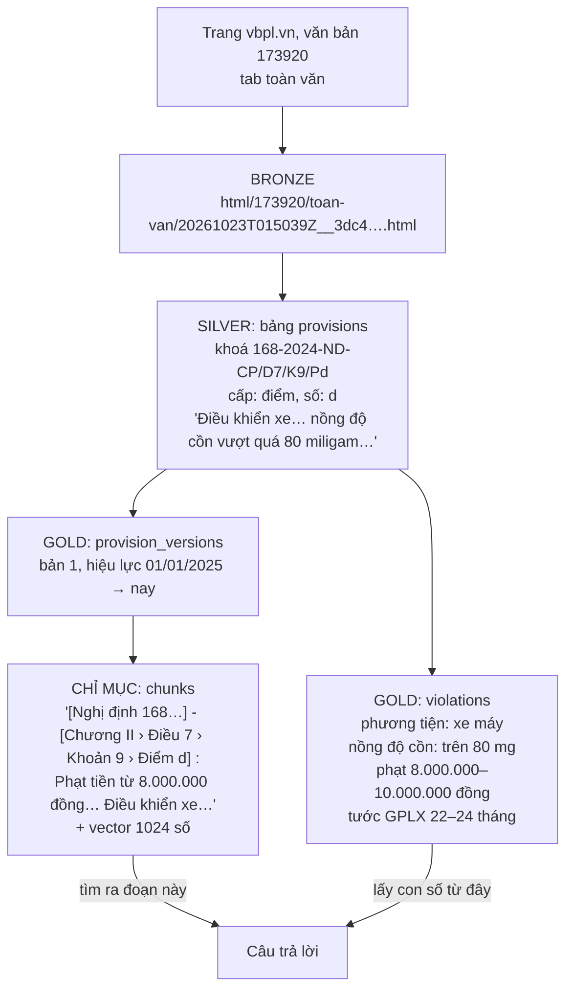

| Tầng | Dữ liệu trông như thế nào | Ai tạo ra |
|---|---|---|
| **Nguồn** | Trang vbpl.vn của NĐ 168/2024 (mã văn bản `173920`) | Cơ sở dữ liệu quốc gia về văn bản pháp luật |
| **Bronze**: bản sao gốc | Các file HTML của từng tab (`toan-van`, `thuoc-tinh`, `luoc-do`, `lich-su`, `tai-ve`) lưu ở `bronze/html/173920/...`, tên file kèm thời điểm crawl và mã băm nội dung | Crawler, ngày 23/10/2026 |
| **Silver**: điều khoản | Một dòng trong bảng `provisions`: khoá `168-2024-ND-CP/D7/K9/Pd`, cấp "điểm", số "d", nội dung "Điều khiển xe trên đường mà trong máu hoặc hơi thở có nồng độ cồn vượt quá 80 miligam/100 mililít máu…". Câu dẫn của khoản 9: "Phạt tiền từ 8.000.000 đồng đến 10.000.000 đồng…" | Bộ tách cấu trúc (quy tắc, không dùng AI) |
| **Gold**: phiên bản | `provision_versions`: bản 1, hiệu lực từ 01/01/2025, chưa bị sửa | Bước áp dụng sửa đổi |
| **Gold**: mức phạt | `violations`: phương tiện = xe máy, nồng độ cồn = trên 80 mg, phạt 8.000.000–10.000.000 đồng, tước GPLX 22–24 tháng | Bước trích mức phạt (quy tắc, không dùng AI) |
| **Chỉ mục** | `chunks`: đoạn văn "[Nghị định 168…] - [Chương II > Mục 1 > Điều 7 … > Khoản 9 > Điểm d] : Phạt tiền từ 8.000.000 đồng… Điều khiển xe…", kèm vector 1024 số | Model bge-m3 |

Từ đó, khi có ai hỏi về xe máy và nồng độ cồn trên 80 mg, hệ thống tìm ra đoạn này và lấy mức phạt **từ bảng `violations`**, không phải đọc rồi đoán.

### 5.2. Sáu bước chuẩn bị dữ liệu

**Bước 1: Thu thập (vbpl.vn → Bronze).**
- Mở trang bằng trình duyệt thật, giãn cách 3–6 giây giữa các lần truy cập.
- Bị chặn thì dừng cả lần chạy, không vượt cơ chế chống bot.
- Lưu nguyên trang gốc và không bao giờ xoá. Khi bộ tách có lỗi, chỉ cần xử lý lại từ bản gốc mà không phải crawl lại.

**Bước 2: Tách cấu trúc (Bronze → Silver).**
- Nhận diện "Chương", "Điều 7.", "9.", "d)" bằng quy tắc (regex), dựng thành cây Chương › Mục › Điều › Khoản › Điểm.
- Mỗi đơn vị có một mã ổn định, ví dụ `168-2024-ND-CP/D7/K9/Pd`.
- Lưu dạng Parquet (định dạng cột, nén tốt, đọc nhanh), chia theo văn bản.

**Bước 3: Áp dụng sửa đổi, tạo phiên bản (Silver → Gold).**
- Đọc câu trong văn bản sửa đổi, ví dụ "Sửa đổi, bổ sung điểm m khoản 3 như sau:" trong NĐ 238/2026.
- Xác định điều khoản bị tác động và ngày hiệu lực, rồi tạo phiên bản mới. Kỹ thuật này gọi là **SCD Type 2**.
- Ví dụ thật, Điểm m khoản 3 Điều 6 NĐ 168 (chở trẻ em trên ô tô):

| Phiên bản | Hiệu lực | Nội dung (rút gọn) |
|---|---|---|
| 1 (NĐ 168/2024) | 01/01/2025 → 15/08/2026 | Chở trẻ em dưới 10 tuổi… ngồi cùng hàng ghế với người lái **hoặc không sử dụng thiết bị an toàn phù hợp cho trẻ em** |
| 2 (NĐ 238/2026) | 15/08/2026 → nay | Chở trẻ em dưới 10 tuổi… ngồi cùng hàng ghế với người lái (vế "thiết bị an toàn" bị bỏ khỏi điểm này) |

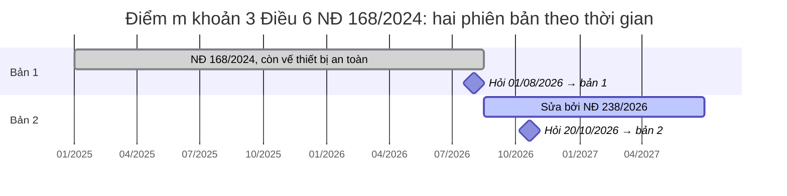

Khi hỏi tại một ngày, hệ thống chỉ lấy phiên bản thoả `hiệu lực từ ≤ ngày < hiệu lực đến`.

Kết quả thật khi hỏi cùng một câu "Chở trẻ em dưới 10 tuổi ngồi ghế trước ô tô bị phạt bao nhiêu?" ở hai ngày khác nhau:

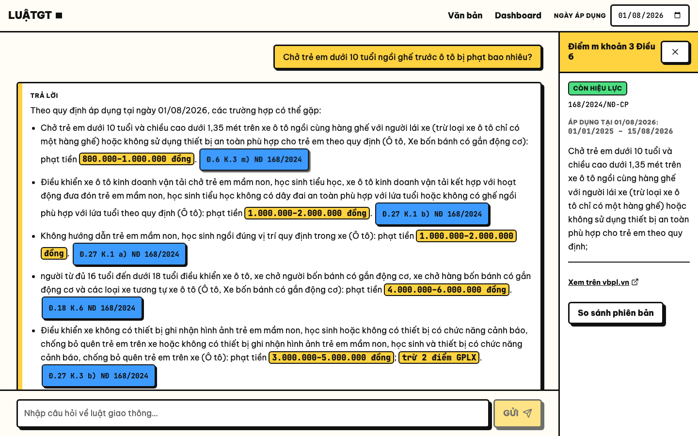
*Ảnh 3. Ngày áp dụng 01/08/2026 (trước NĐ 238): điểm m còn vế "không sử dụng thiết bị an toàn phù hợp cho trẻ em"; cột phải ghi hiệu lực 01/01/2025 – 15/08/2026*

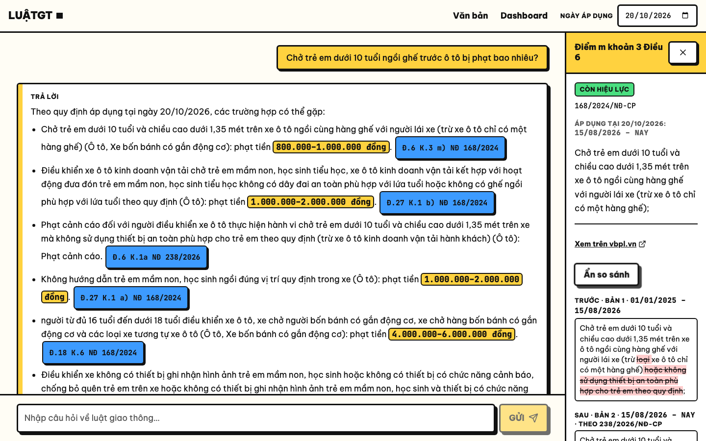
*Ảnh 4. Ngày áp dụng 20/10/2026 (sau NĐ 238): vế đó bị gạch đỏ trong phần so sánh phiên bản và chuyển sang điều khoản mới Đ.6 K.1a NĐ 238/2026 với mức "Phạt cảnh cáo"*

Hai ảnh trên là bằng chứng rõ nhất cho việc "trả lời đúng theo thời điểm": cùng câu hỏi, khác ngày, ra quy định khác nhau, và mỗi quy định trỏ đúng văn bản đã ban hành nó. Toàn kho có 430 thao tác sửa đổi tự động áp được; 19 thao tác phức tạp được đưa vào hàng đợi chờ người kiểm.

**Bước 4: Trích mức phạt.**
- Đọc câu dẫn "Phạt tiền từ X đồng đến Y đồng đối với người điều khiển xe mô tô…" và các điểm bên dưới.
- Mỗi hành vi thành một dòng có cấu trúc: hành vi, phương tiện, nồng độ cồn hoặc tốc độ, mức phạt thấp nhất và cao nhất, trừ điểm, tước GPLX, điều kiện đi kèm.
- Dùng quy tắc, không dùng AI, nên con số chép đúng từ văn bản.

**Bước 5: Kiểm tra chất lượng.**
- Ví dụ quy tắc: mức thấp phải ≤ mức cao; hai phiên bản không được chồng thời gian; số Điều phải liên tục.
- Bản ghi nghi ngờ đi vào **khu cách ly (quarantine)**, không bị bỏ âm thầm. Mỗi bản ghi gắn với lần chạy (`run_id`) đã sinh ra nó.
- Lỗi nghiêm trọng thì dừng việc xuất bản. Dữ liệu mới nạp vào Postgres trong **một transaction**, lỗi giữa chừng thì quay lui, dữ liệu cũ vẫn phục vụ.

**Bước 6: Tạo chỉ mục tìm kiếm.**
- Mỗi Điểm (hoặc Khoản, Điều nếu không có Điểm) thành một đoạn, ghép thêm tên văn bản, đường dẫn mục lục và câu dẫn có mức phạt, để đoạn tự đủ nghĩa.
- Model bge-m3 biến mỗi đoạn thành vector 1024 số. Hai đoạn cùng ý thì vector gần nhau.

### 5.3. Kết quả dữ liệu

| Hạng mục | Số lượng |
|---|---|
| Văn bản | 9 |
| Đơn vị điều khoản | 4.651 |
| Thao tác sửa đổi | 449 (430 áp tự động, 19 chờ kiểm) |
| Phiên bản điều khoản | 5.032 |
| Dòng hành vi vi phạm | 906 |
| Đoạn tìm kiếm | 3.545 |
| Bản ghi quarantine | 31 |

Thời gian chạy lại toàn bộ trên laptop: tách cấu trúc 12,7 giây, tạo phiên bản và mức phạt 8,1 giây, tạo chỉ mục 15,7 giây.

---

## 6. Hệ thống trả lời một câu hỏi thế nào

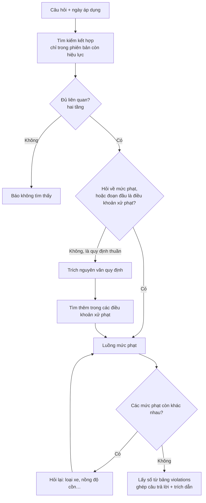

Cùng một câu hỏi, nhìn theo thứ tự các thành phần trao đổi với nhau:

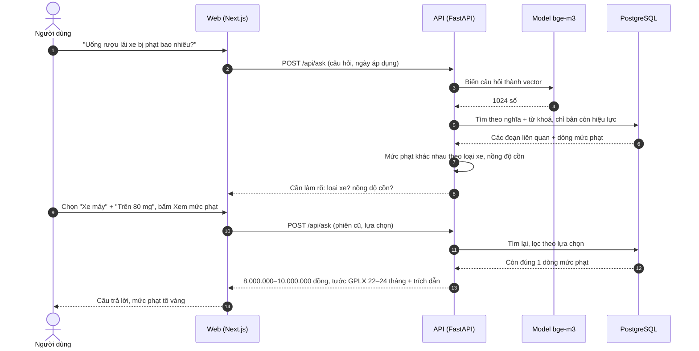

### 6.1. Bước 1: Tìm kiếm kết hợp
Hai cách tìm chạy song song, rồi gộp kết quả:

| Cách tìm | Mạnh ở | Ví dụ |
|---|---|---|
| **Theo nghĩa** (vector, model bge-m3) | Hiểu khi người dùng nói khác văn bản | "uống bia" ↔ "nồng độ cồn trong máu" |
| **Theo từ khoá** (full-text) | Bắt đúng thuật ngữ, số hiệu | "mũ bảo hiểm", "168/2024" |
| **Gộp RRF** | Đoạn được cả hai cách xếp cao sẽ lên đầu | |

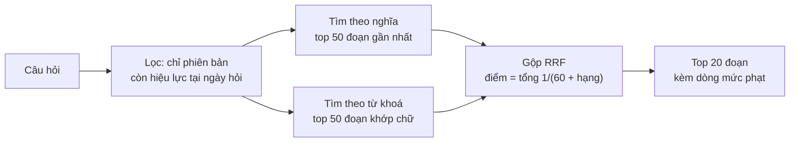

- Chỉ tìm trong các phiên bản **còn hiệu lực tại ngày áp dụng**. Bỏ bộ lọc này đi thì có 9 trường hợp bản luật sai ngày bị xếp lên trước bản đúng.
- Câu đời thường được bổ sung từ trong văn bản luật, ví dụ "vượt đèn đỏ" thêm "không chấp hành hiệu lệnh của đèn tín hiệu".

### 6.2. Bước 2: Có đủ liên quan không (hai tầng)
Mỗi kết quả có một **điểm tương đồng** từ 0 đến 1. Hệ thống chỉ trả lời khi thoả một trong hai tầng:
1. Điểm ≥ **0,55**; hoặc
2. Điểm ≥ **0,50** và **mọi từ** trong câu hỏi đều có trong đoạn tìm được.

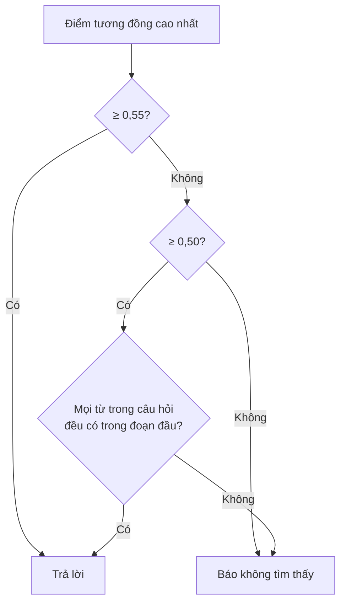

Tầng 2 dành cho câu ngắn kiểu gõ từ khoá: "không đội mũ bảo hiểm" chỉ đạt 0,541 nhưng khớp đủ 4/4 từ. Đo trên 26 câu: 13/14 cụm giao thông ngắn được trả lời, 0/12 câu lạc đề bị trả lời nhầm ("thời tiết hôm nay" chỉ 0,49).

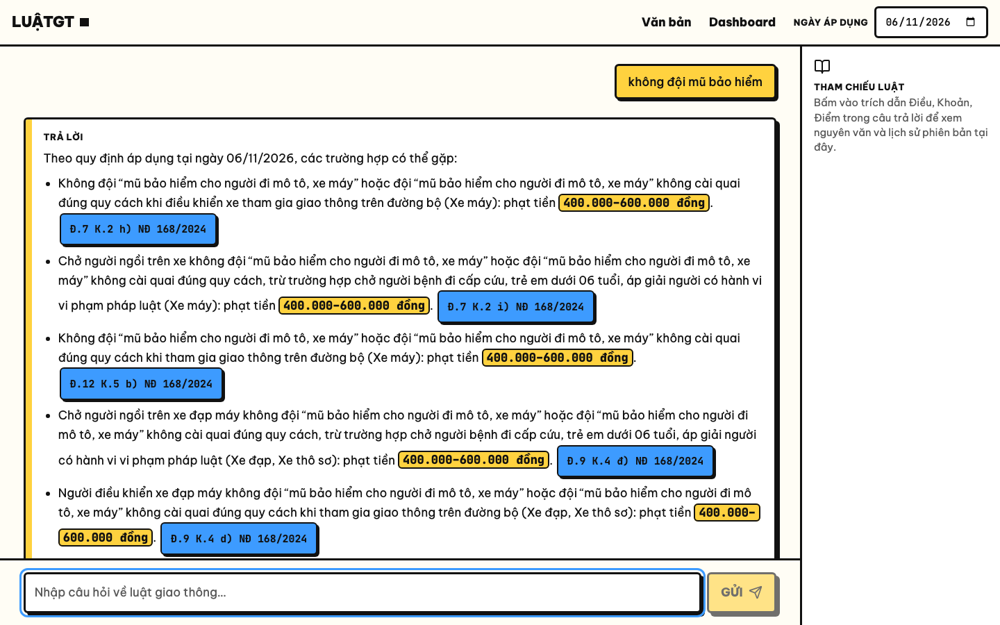
*Ảnh 5. Câu ngắn "không đội mũ bảo hiểm" (điểm 0,541) vẫn được trả lời nhờ tầng 2; mọi mức phạt đều 400.000–600.000 đồng nên không cần hỏi loại xe*

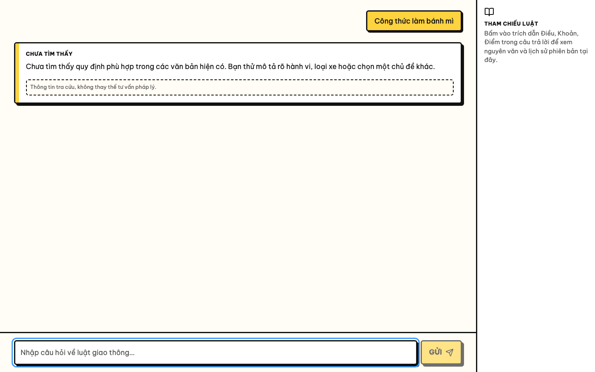
*Ảnh 6. Câu lạc đề "Công thức làm bánh mì": hệ thống báo không tìm thấy thay vì trả lời bừa*

### 6.3. Bước 3: Chọn cách trả lời

| Câu hỏi | Đoạn đứng đầu | Cách trả lời |
|---|---|---|
| Có chữ "phạt", "mức", "xử lý"… | bất kỳ | Đưa ra mức phạt |
| Không có chữ "phạt" | điều khoản xử phạt (ví dụ "không đội mũ bảo hiểm") | Đưa ra mức phạt luôn |
| Không có chữ "phạt" | quy định thuần (ví dụ "chở hàng cồng kềnh" → Điều 33 Luật 36) | Trích nguyên văn quy định, rồi thêm "**Mức phạt liên quan**" |

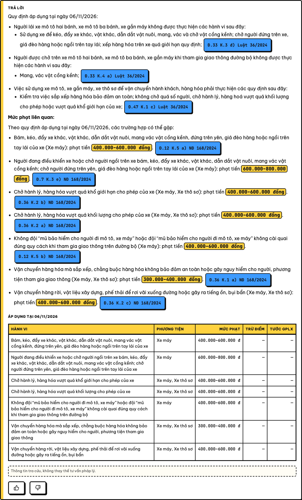
*Ảnh 7. Câu "Chở hàng cồng kềnh" sau khi chọn Xe máy: phần trên trích quy định của Luật 36/2024 (chip xanh), phần dưới "Mức phạt liên quan" lấy từ NĐ 168/2024, mức phạt tô vàng, kèm bảng*

### 6.4. Bước 4: Câu hỏi phụ được sinh ra thế nào
Không có kịch bản hỏi viết sẵn. Hệ thống nhìn vào các dòng mức phạt đang có:
- Nếu tất cả **cùng một mức phạt**, trả lời luôn. Ví dụ "không đội mũ bảo hiểm" là 400.000–600.000 đồng cho mọi loại xe.
- Nếu **khác nhau theo loại xe** và câu hỏi chưa nêu loại xe, luôn hỏi loại xe trước. Danh sách luôn có Xe máy, Ô tô, Xe đạp; chọn loại chưa có trong kết quả thì hệ thống tìm lại theo loại đó.
- Các thông tin khác (nồng độ cồn, tốc độ…) được chọn theo mức độ giúp thu hẹp khoảng phạt. Đo bằng **entropy**: chia theo thông tin nào thì các mức phạt tách ra rõ nhất và chênh nhau nhiều nhất.
- Tối đa 3 lượt hỏi, mỗi lượt tối đa 2 câu, luôn có lựa chọn "Không rõ". Hết lượt mà vẫn còn nhiều mức, hệ thống liệt kê các trường hợp.

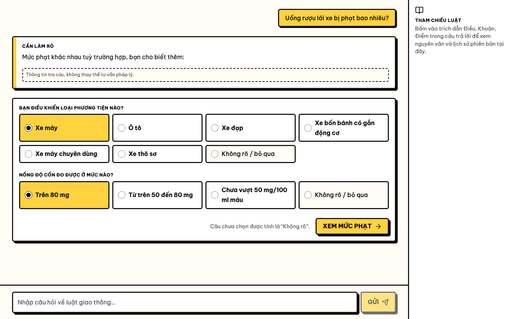
*Ảnh 8. Câu hỏi phụ dạng ô chọn: hệ thống hỏi cùng lúc loại xe và nồng độ cồn; chọn xong bấm "Xem mức phạt" một lần*

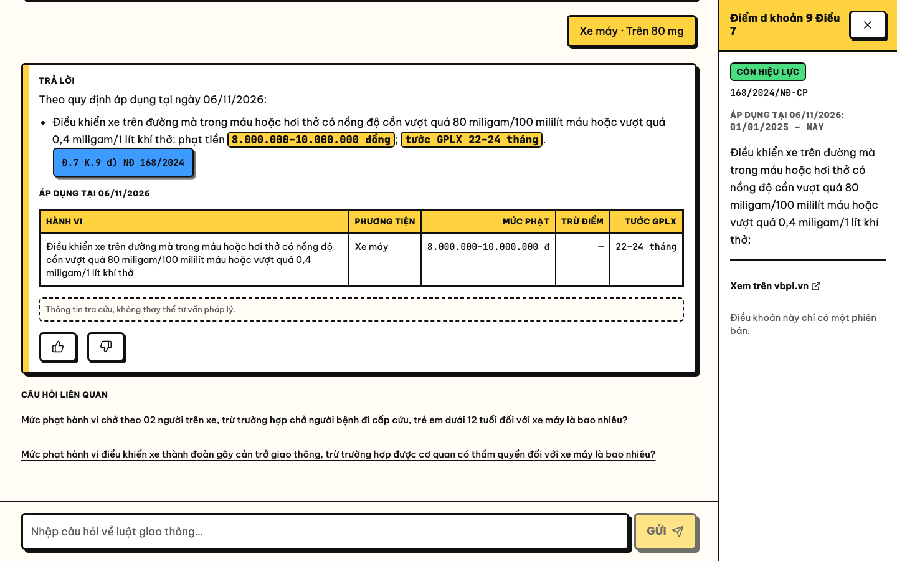
*Ảnh 9. Kết quả sau khi chọn Xe máy và Trên 80 mg: còn đúng một mức 8.000.000–10.000.000 đồng, tước GPLX 22–24 tháng (tô vàng); bấm chip xanh thì nguyên văn hiện ở cột phải*

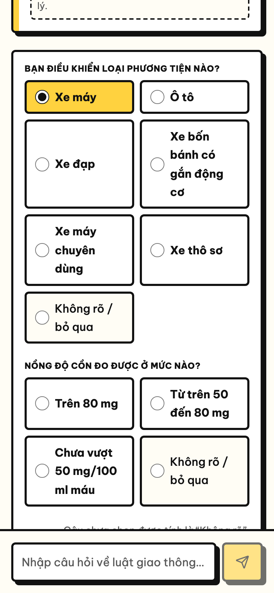
*Ảnh 10. Trên điện thoại: các ô chọn xếp 2 cột, mỗi ô đủ lớn để chạm*

Ví dụ: "Uống rượu lái xe bị phạt bao nhiêu?" ra nhiều mức phạt khác nhau theo loại xe (7 lựa chọn) và nồng độ cồn (3 mức), nên hệ thống hỏi cả hai trong một lượt. Chọn "Xe máy" và "Trên 80 mg" thì còn đúng một dòng.

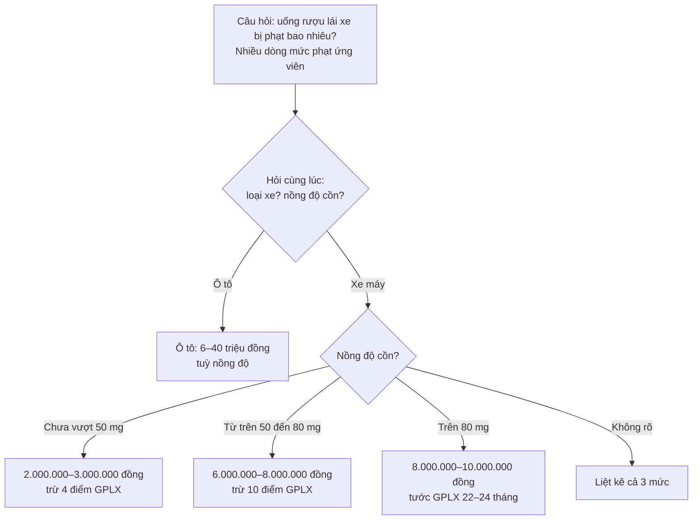

### 6.5. Bước 5: Ghép câu trả lời
- Lấy số từ bảng `violations` rồi đặt vào **mẫu câu có sẵn**: "Theo quy định áp dụng tại ngày …: [hành vi]: phạt tiền [min]–[max] đồng; tước GPLX [x]–[y] tháng. [trích dẫn]".
- Kèm bảng mức phạt, chip trích dẫn mở được nguyên văn, và dòng "không thay thế tư vấn pháp lý".

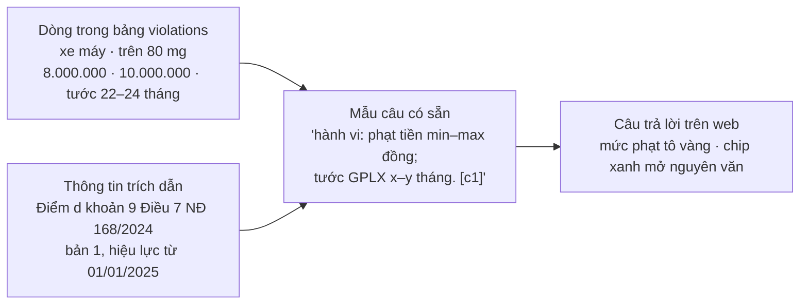

### 6.6. Vai trò của AI: không dùng LLM mà vẫn đúng?

| Việc | Ai làm | Có phải AI? |
|---|---|---|
| Hiểu nghĩa câu hỏi để tìm điều khoản | Model embedding bge-m3 chạy trên máy | **Có**, mạng nơ-ron |
| Chọn phiên bản đúng ngày | Truy vấn dữ liệu | Không |
| Đưa ra mức phạt | Bảng `violations` | Không |
| Quyết định có hỏi lại không | Thuật toán entropy | Không |
| Viết câu trả lời | Mẫu câu có sẵn; LLM là tuỳ chọn | Hiện không |

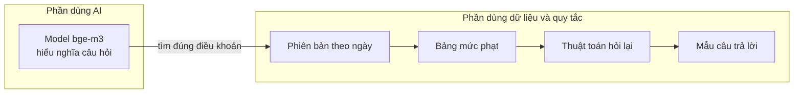

**Câu giải thích ngắn khi thuyết trình:** "Hệ thống có AI, nhưng AI chỉ làm việc nó giỏi nhất là **hiểu câu hỏi để tìm đúng điều khoản**. Con số không do AI nghĩ ra mà **được chép từ văn bản luật vào bảng** từ trước. AI tìm đúng chỗ, dữ liệu quyết định con số."

Vì sao đúng mà không cần LLM:
1. Văn bản luật có cấu trúc rất đều ("Phạt tiền từ X đồng đến Y đồng đối với…"), nên quy tắc trích được chính xác.
2. Mỗi con số truy được về một điều khoản cụ thể, mở ra kiểm được.
3. Bộ lọc hiệu lực chọn đúng phiên bản theo ngày; LLM thường không biết các văn bản mới như NĐ 238/2026.
4. Khi thiếu thông tin, hệ thống hỏi lại thay vì đoán.

Nếu bật LLM (tuỳ chọn), nó chỉ viết lại câu văn cho tự nhiên. Số tiền và trích dẫn bị kiểm tra lại với bảng; sai thì sinh lại một lần, rồi quay về mẫu có sẵn. Chế độ này mới thử bằng client giả, chưa gọi API thật.

Giới hạn cần nói rõ: không phải lúc nào cũng đúng. Trên 66 câu thử (tập dev), 83,3% câu trả lời trích đúng điều khoản. Hệ thống còn yếu với câu hỏi về quy định chung trong luật.

---

## 7. Phân tích hành vi và vận hành

### Streaming

- Mỗi lượt hỏi và phản hồi sinh một event, không lưu thông tin định danh người dùng.
- Spark Structured Streaming đếm theo cửa sổ 10 phút.
- **Watermark** quyết định chờ event trễ bao lâu. **Checkpoint** giúp chạy lại sau sự cố. Ghi kiểu **upsert** để chạy lại không làm sai số.

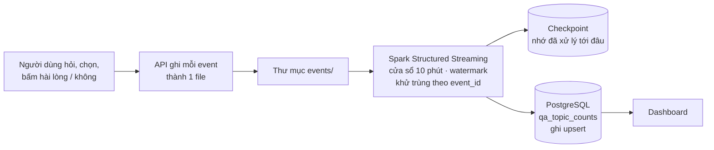

Thí nghiệm trên 6.000 event giả lập, trong đó 8% đến trễ (tỉ lệ tự chọn để so sánh):

| Watermark | Độ đầy đủ | Số dòng bị loại | Độ trễ chốt số | State lớn nhất |
|---|---|---|---|---|
| 5 phút | 93,62% | 402 | 6,8 phút | 391 dòng |
| 15 phút | 97,25% | 173 | 16,8 phút | 1.060 dòng |
| 60 phút (đối chứng) | 100% | 0 | 61,8 phút | 4.089 dòng |

**Thông điệp:** chờ lâu hơn thì đầy đủ hơn, nhưng số ra chậm hơn và tốn bộ nhớ hơn. Khi cố tình ép Spark chạy lại một batch đã ghi sau khi restart, kết quả không lệch ô nào (0/108).

### Orchestration

Airflow điều phối: crawl hằng ngày, kiểm tra lại văn bản hằng tuần, tự chạy build sau khi crawl thành công (Dataset), đánh giá chạy tay.

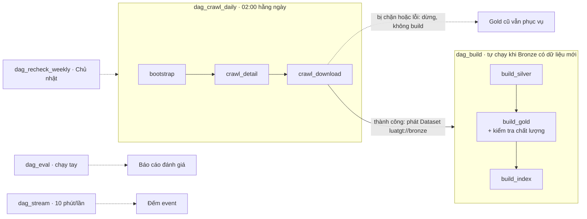

**Kiểm chứng:** chạy toàn bộ từ cơ sở dữ liệu rỗng qua Airflow, kết quả trùng khớp về số dòng và mã băm với dữ liệu đang dùng. Điều này chứng minh pipeline **tái lập được**, chưa chứng minh dữ liệu đúng về mặt pháp lý.

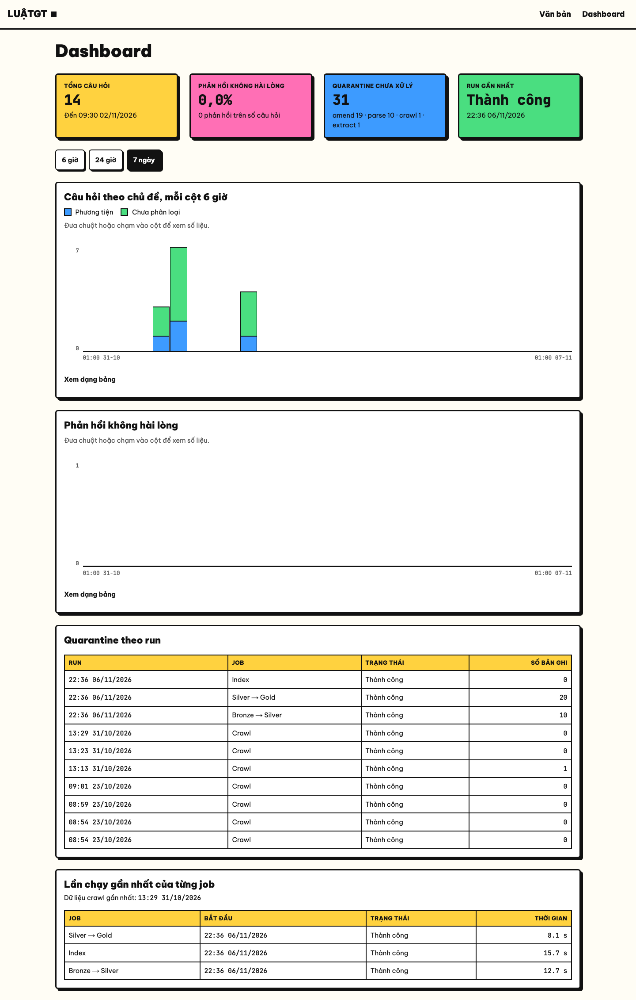
*Ảnh 11. Dashboard (khoảng 7 ngày): số câu hỏi theo chủ đề tính bằng Spark Streaming, quarantine theo từng lần chạy, thời gian chạy và độ tươi dữ liệu của từng job*

**Quan sát vận hành:** mỗi lần chạy job build được ghi vào bảng `job_runs`, gồm trạng thái, thời gian chạy và ngày crawl gần nhất của dữ liệu đầu vào. Dashboard hiển thị các thông tin này. Lần chạy ngày 06/11/2026:

| Job | Thời gian |
|---|---|
| Bronze → Silver | 12,7 s |
| Silver → Gold | 8,1 s |
| Tạo chỉ mục | 15,7 s |

**Nói đúng về "exactly-once":** nguồn event là at-least-once (có thể trùng hoặc trễ). Kết quả tổng hợp đúng một lần là nhờ checkpoint, khử trùng theo `event_id` trong phạm vi watermark, và ghi upsert idempotent. Không gọi đây là exactly-once đầu-cuối.

---

## 8. Kết quả đánh giá

> **Phải nói rõ khi trình bày:** đây là **số trên tập dev**. 66 câu này đã được dùng để chỉnh tham số tìm kiếm (các cụm từ đồng nghĩa, ngưỡng), nên số có phần lạc quan. Theo nguyên tắc "không chọn mô hình trên tập test" (P11), kết quả cuối phải đo trên tập test gồm câu mới, do thành viên không chỉnh tham số soạn trước khi chạy hệ thống. **Tập test chưa có.**

Đo trên 66 câu dev; đáp án là bản nháp, nhóm chưa đối chiếu với văn bản gốc. Chạy `eval/run_eval.py` hai lần cho cùng số liệu, và báo cáo có thẻ tái lập (commit, hash bộ câu hỏi và cấu hình, md5 dữ liệu).

| Chỉ số | Kết quả |
|---|---|
| Recall@5 (Hybrid + lọc hiệu lực) | 87,9% |
| Recall@20 | 92,4% |
| Câu trả lời có trích đúng điều khoản | 83,3% |
| Trích dẫn đúng trên tổng số trích dẫn | 21,2% |
| Trả lời đúng phiên bản | 95,0% (20 câu) |
| Dòng đầu tiên đúng mức phạt | 80,0% (60 câu có mức phạt) |
| Số vòng hỏi phụ trung bình | 1,00 (14 câu có hỏi lại) |

Số liệu đo ngày 06/11/2026, sau khi thêm "luôn hỏi loại xe" và "mức phạt liên quan" (D-029, D-030). So với trước: trích đúng điều khoản 80,3% → 83,3%, đúng phiên bản 90% → 95%; tỉ lệ trích dẫn đúng trên tổng giảm nhẹ 22,6% → 21,2% vì câu trả lời có thêm trích dẫn.

So sánh cấu hình tìm kiếm:

| Cấu hình | Recall@5 | Kết quả sai phiên bản xếp trước |
|---|---|---|
| Vector | 81,8% | 0 |
| Từ khoá | 77,3% | 0 |
| Hybrid, không lọc hiệu lực | 84,8% | **9** |
| Hybrid + lọc hiệu lực | 87,9% | **0** |

**Thông điệp:** bộ lọc hiệu lực loại hoàn toàn trường hợp bản luật sai ngày xếp trước bản đúng.

Chỉ số tách theo nhóm (P12; vẫn là số dev, mẫu nhỏ):

| Nhóm | Recall@5 | Trích đúng điều khoản |
|---|---|---|
| Tổng | 87,9% (58/66) | 83,3% (55/66) |
| Ô tô | 89,7% (26/29) | 89,7% (26/29) |
| Xe máy | 90,5% (19/21) | 76,2% (16/21) |
| Câu không nêu loại xe | 78,6% (11/14) | 78,6% (11/14) |
| Đáp án nằm trong NĐ 168/2024 | 93,3% (56/60) | 88,3% (53/60) |
| Đáp án nằm ở luật và nghị định khác | 2/6 | 2/6 |

**Thông điệp:** con số trung bình che đi điểm yếu. Hệ thống làm tốt với câu về mức phạt trong NĐ 168, nhưng yếu với câu về quy định chung trong luật; 4/8 câu trượt Recall@5 thuộc nhóm này.

Lưu ý khi trình bày:

- Recall có phần lạc quan, vì các cụm từ đồng nghĩa được chọn sau khi xem câu trượt của chính bộ eval.
- Thí nghiệm có và không có câu hỏi phụ chưa cho khác biệt đo được: "dòng đầu đúng mức phạt" đều là 80,0%; có câu hỏi phụ thì câu trả lời ngắn hơn (3,9 dòng so với 4,2). Thước đo "dòng đầu" còn thô.
- Parse accuracy và Extraction accuracy chưa được kiểm tay.

---

## 9. Giải pháp cải thiện đề xuất

Xếp theo mức ưu tiên:

| Ưu tiên | Vấn đề | Giải pháp | Lợi ích |
|---|---|---|---|
| 1 | Thiếu văn bản sửa đổi: NĐ 336/2025, NĐ 319/2026, Luật 143/2025 | Thêm vào seed, kiểm tra lại hiệu lực | Tránh trả lời theo quy định đã cũ |
| 2 | Chỉ 21,2% trích dẫn trỏ đúng, câu trả lời lẫn hành vi gần nghĩa | Thêm bước xếp hạng lại, lọc ứng viên chặt hơn | Câu trả lời ngắn và chính xác hơn |
| 3 | Chưa có tập test; 66 câu dev có đáp án chưa kiểm | Soạn ≥ 34 câu test mới (đã có hạ tầng tách dev/test), nhóm đối chiếu tay, thêm câu lạc đề | Số liệu đáng tin để báo cáo |
| 3b | Yếu với câu hỏi về quy định chung trong luật (2/6) | Thêm câu dev cho nhóm này, xem lại chunk của Luật 36/2024 và 35/2024 | Bớt phụ thuộc vào một nghị định |
| 4 | Chưa từ chối câu khó: 66/66 câu đều được trả lời | Hiệu chỉnh ngưỡng trên bộ câu lạc đề, báo độ tin cậy | Giảm trả lời sai một cách tự tin |
| 5 | Chưa hỏi thời điểm vi phạm, chưa có số trang PDF | Thêm chiều `thoi_diem`, khớp Điều với trang PDF | Đủ yêu cầu thiết kế |
| 6 | Văn phong template khô | Bật LLM có kiểm tra sau sinh, thử nghiệm với API thật | Dễ đọc hơn, đổi lại có chi phí |
| 7 | Mỗi event một file, Airflow chạy bản dev | Chuyển Kafka (key = `session_id`, `acks=all`, idempotent producer), dùng executor và DB thật khi triển khai | Sẵn sàng cho lưu lượng lớn |
| 8 | Silver chỉ là thư mục Parquet, chưa có transaction log | Chuyển Delta Lake khi có ghi đồng thời hoặc cần time travel; hiện an toàn nhờ Airflow chạy tuần tự | Commit nguyên tử, đọc snapshot nhất quán |
| 9 | API dùng chung tài khoản DB với pipeline | Role quyền tối thiểu: chỉ đọc dữ liệu luật, chỉ ghi `qa_sessions` | Giảm rủi ro bảo mật |
| 10 | Chưa có bằng chứng Spark (query plan, stage, cache, so sánh định dạng file) | Lưu `explain`, số liệu stage, so sánh có và không có cache, CSV/JSON/Parquet vào `docs/evidence/` | Chứng minh được lựa chọn kỹ thuật bằng số đo |

---

## 10. Dàn ý thuyết trình (12 phút, 8 slide nội dung)

Slide tiêu đề và slide nguồn tham khảo không tính vào 8 slide nội dung. Thời lượng là gợi ý; "Người nói" để nhóm tự điền, mỗi thành viên ít nhất một slide.

| Slide | Nội dung | Sơ đồ và ảnh nên dùng | Kiến thức môn học | Phút | Người nói |
|---|---|---|---|---|---|
| 0 | Tên đề tài, thành viên | | | 0,5 | |
| 1 | **Vấn đề và câu hỏi dẫn dắt:** luật đổi theo thời gian, người dân dùng từ khác luật, sai số có hậu quả | Bảng "Khó khăn" mục 1 | | 1 | |
| 2 | **Giải pháp và demo ngắn:** hỏi → hỏi lại → trả lời có trích dẫn → đổi ngày áp dụng | Ảnh 1, 8, 10 (hoặc demo trực tiếp); sơ đồ tuần tự mục 6 | | 2 | |
| 3 | **Kiến trúc:** hai luồng (chuẩn bị dữ liệu / trả lời), vì sao không chỉ dùng Postgres, vì sao chưa Delta Lake | Sơ đồ hai luồng và sơ đồ kiến trúc mục 4; Ảnh 2 | P16; FDE Ch.3 | 1,5 | |
| 4 | **Dữ liệu đi qua Bronze → Silver → Gold:** theo chân Điểm d khoản 9 Điều 7 NĐ 168 | Sơ đồ medallion và sơ đồ hành trình mục 5 | P07, P14; FDE Ch.6, Ch.8 | 1,5 | |
| 5 | **Phiên bản theo ngày và tìm kiếm có lọc hiệu lực:** bộ lọc đưa bản sai ngày xếp trước từ 9 về 0 | Sơ đồ dòng thời gian mục 5.2; **Ảnh 3–4** (cùng câu, hai ngày); sơ đồ tìm kiếm mục 6.1 | FDE Ch.8, Ch.9 | 1,5 | |
| 6 | **Hỏi lại thông minh và vai trò của AI:** vì sao không cần LLM mà con số vẫn đúng | Sơ đồ thu hẹp mức phạt mục 6.4; Ảnh 7, 9; sơ đồ vai trò AI mục 6.6 | | 1,5 | |
| 7 | **Streaming, vận hành và đánh giá trung thực:** watermark, Airflow, số dev, điểm yếu theo nhóm | Sơ đồ streaming, sơ đồ Airflow mục 7; Ảnh 11; bảng mục 8 | P09–P12; NIST AI RMF | 1,5 | |
| 8 | **Hạn chế và bước tiếp theo** | Bảng mục 9 | P14, P16 | 1 | |
| | Nguồn tham khảo và khai báo dùng AI | | | | |

**Ảnh minh hoạ** nằm trong `docs/images/` (PNG, chụp từ hệ thống thật ngày 06/11/2026), dùng thẳng cho slide. Muốn chụp lại sau khi giao diện đổi: bật API và web, rồi chạy `.venv/bin/python scripts/take_screenshots.py docs/images`.

**Xuất sơ đồ ra ảnh để đưa vào slide:** dán khối `mermaid` vào [mermaid.live](https://mermaid.live), rồi tải PNG hoặc SVG. Các sơ đồ trong file này đã được render thử, không lỗi.

Tổng khoảng 12 phút. Muốn rút ngắn thì gộp slide 5 vào slide 4.

**Khai báo dùng AI (gợi ý):** code, spec và tài liệu này được viết với hỗ trợ của Claude (Claude Code). Đáp án eval là bản nháp do AI soạn, nhóm chưa đối chiếu. Mọi số liệu trong slide lấy từ lần chạy thật, có báo cáo và thẻ tái lập trong repo.

**Nguồn cần ghi trên slide:**
- Reis & Housley, *Fundamentals of Data Engineering* (chương ghi ở từng slide).
- Spark Structured Streaming Programming Guide: reading list dẫn bản 3.5.8, dự án chạy Spark 4.2.0, nên ghi cả hai.
- NIST AI RMF 1.0; NIST Privacy Framework.
- Tài liệu Delta Lake (slide 3, 8); Kafka documentation (slide 6).
- Nguồn dữ liệu: vbpl.vn.

### Câu chốt gợi ý

Hệ thống không cố làm một chatbot biết mọi thứ. Nó trả lời đúng theo thời điểm, chỉ ra căn cứ để người dùng tự kiểm chứng, và hỏi lại khi chưa đủ thông tin. Đây là công cụ tra cứu, không thay thế tư vấn pháp lý.

### Câu hỏi phản biện có thể gặp

| Câu hỏi | Gợi ý trả lời |
|---|---|
| Vì sao không chỉ dùng ChatGPT? | Mô hình có thể không biết bản sửa đổi mới và có thể tự nghĩ ra số; ở đây số liệu lấy từ bảng và có trích dẫn |
| Không có LLM thì có phải AI không? | Có, phần tìm kiếm dùng model embedding; LLM chỉ dùng để viết câu văn |
| Dữ liệu sai thì sao? | Bản ghi nghi ngờ vào quarantine, người dùng mở được nguyên văn; hiện đáp án eval và mẫu trích xuất còn cần nhóm kiểm tay |
| Vì sao cần streaming cho log? | Log có thể đến trễ và trùng, đây là bài toán event time; còn văn bản luật cập nhật theo ngày nên dùng batch |
| Hệ thống có thu thập dữ liệu cá nhân không? | Không lưu thông tin định danh người dùng |
| Số 87,9% có tin được không? | Đó là số dev, đã dùng để chỉnh tham số nên lạc quan; kết quả cuối cần tập test mới, hạ tầng tách dev/test đã có |
| Có "exactly-once" không? | Nguồn là at-least-once; số tổng hợp đúng một lần nhờ checkpoint, khử trùng theo `event_id` và upsert idempotent. Không phải exactly-once đầu-cuối |
| Vì sao không dùng HDFS? | File luật vài trăm KB, rất nhỏ so với block 128 MB, sẽ gây vấn đề nhiều file nhỏ cho NameNode; object storage hợp hơn (P01) |
| Vì sao chưa dùng Delta Lake hay Kafka? | Chưa có ghi đồng thời và lưu lượng còn nhỏ; điều kiện chuyển đổi đã ghi rõ trong spec 5.4 và 13.4 |
| Dữ liệu nhỏ vậy sao gọi là big data? | Hệ thống minh hoạ cơ chế (phân vùng, phiên bản, streaming, tái lập) và ghi ngưỡng khi nào phải đổi thiết kế; không tuyên bố hiệu năng production |
| Pipeline lỗi giữa chừng thì sao? | Mỗi lần chạy ghi vào `job_runs`; Gold nạp trong một transaction nên rollback, dữ liệu cũ vẫn phục vụ |
| Không dùng LLM sao trả lời đúng? | AI (bge-m3) chỉ dùng để hiểu câu hỏi và tìm điều khoản; con số được chép từ văn bản vào bảng từ trước bằng quy tắc, nên không bị bịa; mỗi số truy được về một điều khoản |
| Người dùng gõ quá ngắn thì sao? | Ngưỡng hai tầng: câu ngắn được nhận nếu mọi từ đều có trong điều khoản tìm được; đo 13/14 cụm ngắn được trả lời, 0/12 câu lạc đề bị nhận nhầm |
| Câu hỏi không nói loại xe? | Nếu mức phạt khác nhau theo loại xe thì luôn hỏi lại; nếu mọi loại xe cùng mức thì trả lời luôn |
| Hỏi về quy định thì có ra mức phạt không? | Có: trích nguyên văn quy định rồi kèm "Mức phạt liên quan" |
