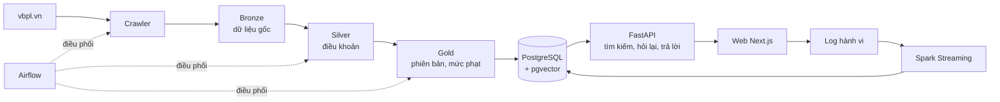
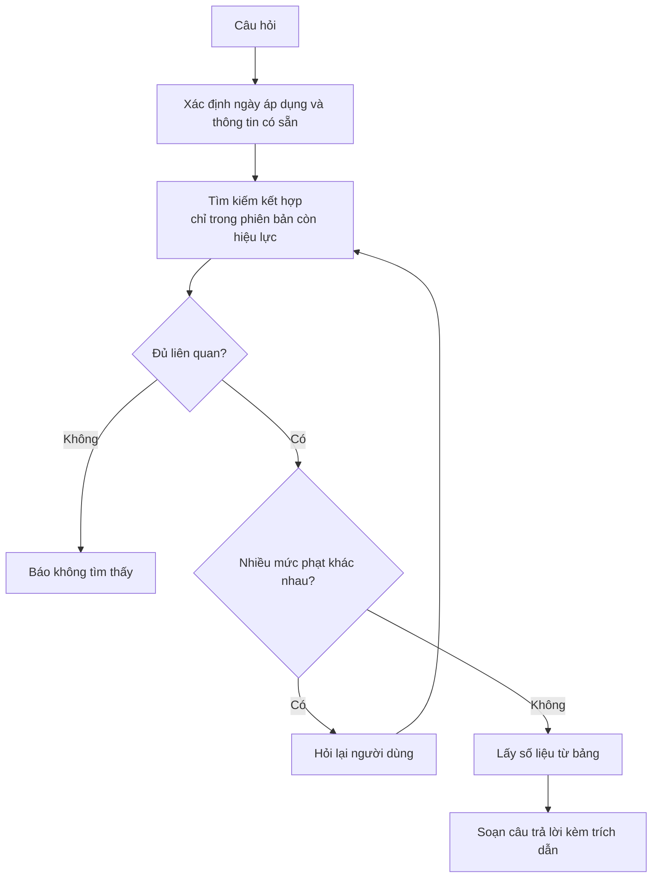

# LuậtGT: tra cứu luật giao thông có trích dẫn

Tài liệu nguồn cho bài thuyết trình. Số liệu lấy từ lần chạy ngày 06/11/2026, khớp với spec v1.1 (`LuatGT_System_Design.md`).

**Khung thuyết trình theo reading list:**
- 12 phút trình bày cộng 3 phút hỏi đáp; tối đa 8 slide nội dung; mọi thành viên đều nói.
- Ghi nguồn cho mọi nhận định mượn từ tài liệu, và ghi rõ phần nào có dùng AI hỗ trợ.

---

## 1. Vấn đề

Người dùng hỏi một câu rất đời thường: "Uống rượu lái xe bị phạt bao nhiêu?". Trả lời đúng câu này khó hơn vẻ ngoài vì:

| Khó khăn | Ví dụ |
|---|---|
| Luật thay đổi theo thời gian | NĐ 168/2024/NĐ-CP được NĐ 238/2026/NĐ-CP sửa đổi từ 15/08/2026 |
| Một câu hỏi có nhiều đáp án | Mức phạt phụ thuộc loại xe và nồng độ cồn |
| Nội dung nằm rải rác | Quy định nằm trong luật, nghị định xử phạt, nghị định hướng dẫn và văn bản sửa đổi |
| Người dùng và luật dùng từ khác nhau | "Vượt đèn đỏ" so với "không chấp hành hiệu lệnh của đèn tín hiệu giao thông" |
| Sai số trong lĩnh vực pháp lý có hậu quả thật | Chatbot thông thường có thể tự nghĩ ra mức phạt |

**Câu hỏi đặt ra:** làm sao để trả lời nhanh, đúng thời điểm, có căn cứ kiểm chứng được, và không để AI tự đặt ra con số?

---

## 2. Giải pháp đề xuất

Xây dựng một hệ thống tra cứu gồm năm ý chính:

1. **Lấy dữ liệu từ nguồn chính thức:** thu thập từ vbpl.vn, cơ sở dữ liệu quốc gia về văn bản pháp luật.
2. **Lưu luật theo phiên bản:** mỗi điều khoản biết rõ nội dung của mình tại từng khoảng thời gian.
3. **Số liệu lấy từ bảng, không lấy từ AI:** mức phạt được trích sẵn vào bảng dữ liệu có cấu trúc.
4. **Hỏi lại khi chưa đủ thông tin:** thay vì đoán, hệ thống hỏi loại xe, nồng độ cồn.
5. **Luôn có trích dẫn:** mỗi câu trả lời dẫn tới đúng điểm, khoản, điều và mở được nguyên văn.

Nguyên tắc xuyên suốt: **AI tìm đúng chỗ, dữ liệu quyết định con số.**

---

## 3. Người dùng thấy gì

| Trang | Chức năng |
|---|---|
| `/` Hỏi đáp | Hỏi bằng ngôn ngữ tự nhiên, chọn ngày áp dụng, trả lời câu hỏi phụ, mở nguyên văn |
| `/van-ban` | Danh sách văn bản, lọc theo tình trạng hiệu lực |
| `/van-ban/[id]` | Mục lục, nội dung tại một ngày, quan hệ sửa đổi, lịch sử phiên bản |
| `/dashboard` | Số câu hỏi theo chủ đề, phản hồi không hài lòng, dữ liệu cần kiểm tra |

### Kịch bản demo

| Bước | Thao tác | Kết quả |
|---|---|---|
| 1 | Hỏi "Uống rượu lái xe bị phạt bao nhiêu?" | Hệ thống chưa trả lời, hỏi loại xe và nồng độ cồn |
| 2 | Chọn "Xe máy" | Hỏi tiếp nồng độ cồn |
| 3 | Chọn "Trên 80 mg" | Phạt 8.000.000–10.000.000 đồng, tước GPLX 22–24 tháng |
| 4 | Bấm chip trích dẫn | Mở nguyên văn Điểm d khoản 9 Điều 7 NĐ 168/2024/NĐ-CP |
| 5 | Mở một điều khoản đã bị sửa, bấm "So sánh phiên bản" | Thấy phần được thêm hoặc xoá giữa hai bản |
| 6 | Hỏi "Công thức làm bánh mì" | Hệ thống báo không tìm thấy, không tự trả lời |

---

## 4. Tổng quan kiến trúc

Hệ thống gồm hai luồng tách biệt:

- **Luồng xử lý trước (batch):** chạy theo lịch, biến văn bản thô thành dữ liệu sẵn sàng tra cứu.
- **Luồng phục vụ (online):** khi có câu hỏi, chỉ tra cứu dữ liệu đã chuẩn bị. Đây là lý do hệ thống trả lời nhanh.

| Thành phần | Công nghệ |
|---|---|
| Thu thập | Playwright |
| Xử lý dữ liệu | PySpark |
| Lưu trữ | MinIO (Parquet, file gốc), PostgreSQL + pgvector |
| Tìm kiếm | Embedding bge-m3 kết hợp tìm từ khoá |
| Backend | FastAPI |
| Frontend | Next.js, TypeScript, Tailwind |
| Streaming | Spark Structured Streaming |
| Điều phối | Apache Airflow |

---

## 5. Luồng xử lý dữ liệu

### Bước 1: Thu thập

- Mở trang bằng trình duyệt thật, giãn cách 3–6 giây giữa các lần truy cập.
- Bị chặn thì dừng cả lần chạy, không thử lại dồn dập và không vượt cơ chế chống bot.
- Dữ liệu gốc được giữ lại, nên có thể xử lý lại mà không cần crawl lại.

### Bước 2: Tách cấu trúc (Bronze sang Silver)

Toàn văn được tách thành cây Chương, Mục, Điều, Khoản, Điểm. Mỗi đơn vị có một mã ổn định, ví dụ `168-2024-ND-CP/D7/K9/Pd` là Điểm d khoản 9 Điều 7 của NĐ 168/2024.

### Bước 3: Áp dụng sửa đổi và tạo phiên bản (Silver sang Gold)

Hệ thống đọc các câu như "sửa đổi điểm a khoản 2 Điều 6", xác định điều khoản bị tác động và ngày hiệu lực, rồi tạo phiên bản mới. Phương pháp này là **SCD Type 2**:

| Điều khoản | Phiên bản | Hiệu lực từ | Đến |
|---|---|---|---|
| Điểm X | 1 | 01/01/2025 | 15/08/2026 |
| Điểm X | 2 | 15/08/2026 | nay |

Khi hỏi tại một ngày, hệ thống chỉ lấy phiên bản thoả `valid_from <= ngày < valid_to`.

### Bước 4: Trích mức phạt

Mỗi hành vi vi phạm được trích thành một dòng có cấu trúc: hành vi, phương tiện, mức phạt thấp nhất và cao nhất, trừ điểm, tước GPLX, điều kiện đi kèm.

### Bước 5: Kiểm tra chất lượng

Bản ghi nghi ngờ đi vào khu cách ly (quarantine), không bị bỏ âm thầm. Mỗi bản ghi gắn với lần chạy (`run_id`) sinh ra nó, nên truy được lỗi đến từ lần crawl hay lần build nào. Lỗi nghiêm trọng dừng việc xuất bản, dữ liệu cũ vẫn phục vụ: Gold được nạp vào Postgres trong **một transaction**, lỗi giữa chừng thì rollback, không có trạng thái nửa vời.

### Bước 6: Tạo chỉ mục tìm kiếm

Nội dung được chia thành các đoạn nhỏ (chunk) theo đơn vị pháp lý, mỗi đoạn được chuyển thành vector 1024 chiều.

### Kết quả dữ liệu

| Hạng mục | Số lượng |
|---|---|
| Văn bản | 9 |
| Đơn vị điều khoản | 4.651 |
| Thao tác sửa đổi | 449 |
| Phiên bản điều khoản | 5.032 |
| Dòng hành vi vi phạm | 906 |
| Đoạn tìm kiếm | 3.545 |
| Bản ghi quarantine | 31 |

---

## 6. Luồng trả lời một câu hỏi

### Tìm kiếm kết hợp

| Cách tìm | Mạnh ở |
|---|---|
| Vector | Hiểu nghĩa khi cách nói khác nhau |
| Từ khoá | Bắt đúng thuật ngữ, số hiệu |
| Hợp nhất RRF | Gộp hai danh sách theo thứ hạng |

Câu có độ tương đồng tốt nhất dưới 0,55 được coi là không liên quan.

### Câu hỏi phụ được sinh như thế nào

Không có kịch bản hỏi viết sẵn. Hệ thống xem các mức phạt ứng viên, rồi tính xem hỏi thông tin nào giúp phân biệt được nhiều nhất và làm khoảng mức phạt thu hẹp nhiều nhất (entropy kết hợp độ chênh mức phạt). Tối đa 3 vòng, luôn có lựa chọn "Không rõ".

### Vai trò của AI

| Việc | Ai làm |
|---|---|
| Hiểu nghĩa câu hỏi để tìm điều khoản | Model embedding chạy trên máy |
| Chọn phiên bản đúng ngày | Truy vấn dữ liệu |
| Đưa ra mức phạt | Bảng `violations` |
| Quyết định có hỏi lại không | Thuật toán |
| Viết câu trả lời | Mẫu có sẵn (hiện tại) hoặc LLM (tuỳ chọn) |

Bản demo hiện **không dùng LLM**. Nếu bật LLM, nó chỉ viết lại câu văn; trích dẫn và số tiền bị kiểm tra sau khi sinh, sai thì sinh lại một lần rồi quay về mẫu có sẵn. Chế độ này mới được kiểm thử bằng client giả, chưa gọi API thật.

---

## 7. Phân tích hành vi và vận hành

### Streaming

- Mỗi lượt hỏi và phản hồi sinh một event, không lưu thông tin định danh người dùng.
- Spark Structured Streaming đếm theo cửa sổ 10 phút.
- **Watermark** quyết định chờ event trễ bao lâu. **Checkpoint** giúp chạy lại sau sự cố. Ghi kiểu **upsert** để chạy lại không làm sai số.

Thí nghiệm trên 6.000 event giả lập, trong đó 8% đến trễ (tỉ lệ tự chọn để so sánh):

| Watermark | Độ đầy đủ | Số dòng bị loại | Độ trễ chốt số | State lớn nhất |
|---|---|---|---|---|
| 5 phút | 93,62% | 402 | 6,8 phút | 391 dòng |
| 15 phút | 97,25% | 173 | 16,8 phút | 1.060 dòng |
| 60 phút (đối chứng) | 100% | 0 | 61,8 phút | 4.089 dòng |

**Thông điệp:** chờ lâu hơn thì đầy đủ hơn, nhưng số ra chậm hơn và tốn bộ nhớ hơn. Khi cố tình ép Spark chạy lại một batch đã ghi sau khi restart, kết quả không lệch ô nào (0/108).

### Orchestration

Airflow điều phối: crawl hằng ngày, kiểm tra lại văn bản hằng tuần, tự chạy build sau khi crawl thành công (Dataset), đánh giá chạy tay.

**Kiểm chứng:** chạy toàn bộ từ cơ sở dữ liệu rỗng qua Airflow, kết quả trùng khớp về số dòng và mã băm với dữ liệu đang dùng. Điều này chứng minh pipeline **tái lập được**, chưa chứng minh dữ liệu đúng về mặt pháp lý.

**Quan sát vận hành:** mỗi lần chạy job build được ghi vào bảng `job_runs`, gồm trạng thái, thời gian chạy và ngày crawl gần nhất của dữ liệu đầu vào. Dashboard hiển thị các thông tin này. Lần chạy ngày 06/11/2026:

| Job | Thời gian |
|---|---|
| Bronze → Silver | 12,7 s |
| Silver → Gold | 8,1 s |
| Tạo chỉ mục | 15,7 s |

**Nói đúng về "exactly-once":** nguồn event là at-least-once (có thể trùng hoặc trễ). Kết quả tổng hợp đúng một lần là nhờ checkpoint, khử trùng theo `event_id` trong phạm vi watermark, và ghi upsert idempotent. Không gọi đây là exactly-once đầu-cuối.

---

## 8. Kết quả đánh giá

> **Phải nói rõ khi trình bày:** đây là **số trên tập dev**. 66 câu này đã được dùng để chỉnh tham số tìm kiếm (các cụm từ đồng nghĩa, ngưỡng), nên số có phần lạc quan. Theo nguyên tắc "không chọn mô hình trên tập test" (P11), kết quả cuối phải đo trên tập test gồm câu mới, do thành viên không chỉnh tham số soạn trước khi chạy hệ thống. **Tập test chưa có.**

Đo trên 66 câu dev; đáp án là bản nháp, nhóm chưa đối chiếu với văn bản gốc. Chạy `eval/run_eval.py` hai lần cho cùng số liệu, và báo cáo có thẻ tái lập (commit, hash bộ câu hỏi và cấu hình, md5 dữ liệu).

| Chỉ số | Kết quả |
|---|---|
| Recall@5 (Hybrid + lọc hiệu lực) | 87,9% |
| Recall@20 | 92,4% |
| Câu trả lời có trích đúng điều khoản | 80,3% |
| Trích dẫn đúng trên tổng số trích dẫn | 22,6% |
| Trả lời đúng phiên bản | 90,0% (20 câu) |
| Số vòng hỏi phụ trung bình | 1,00 (11 câu có hỏi lại) |

So sánh cấu hình tìm kiếm:

| Cấu hình | Recall@5 | Kết quả sai phiên bản xếp trước |
|---|---|---|
| Vector | 81,8% | 0 |
| Từ khoá | 77,3% | 0 |
| Hybrid, không lọc hiệu lực | 84,8% | **9** |
| Hybrid + lọc hiệu lực | 87,9% | **0** |

**Thông điệp:** bộ lọc hiệu lực loại hoàn toàn trường hợp bản luật sai ngày xếp trước bản đúng.

Chỉ số tách theo nhóm (P12; vẫn là số dev, mẫu nhỏ):

| Nhóm | Recall@5 | Trích đúng điều khoản |
|---|---|---|
| Tổng | 87,9% (58/66) | 80,3% (53/66) |
| Ô tô | 89,7% (26/29) | 89,7% (26/29) |
| Xe máy | 90,5% (19/21) | 71,4% (15/21) |
| Đáp án nằm trong NĐ 168/2024 | 93,3% (56/60) | 85,0% (51/60) |
| Đáp án nằm ở luật và nghị định khác | 2/6 | 2/6 |

**Thông điệp:** con số trung bình che đi điểm yếu. Hệ thống làm tốt với câu về mức phạt trong NĐ 168, nhưng yếu với câu về quy định chung trong luật; 4/8 câu trượt Recall@5 thuộc nhóm này.

Lưu ý khi trình bày:

- Recall có phần lạc quan, vì các cụm từ đồng nghĩa được chọn sau khi xem câu trượt của chính bộ eval.
- Thí nghiệm có và không có câu hỏi phụ chưa cho khác biệt đo được: "dòng đầu đúng mức phạt" đều là 76,7%, số dòng giảm từ 4,1 xuống 3,8.
- Parse accuracy và Extraction accuracy chưa được kiểm tay.

---

## 9. Giải pháp cải thiện đề xuất

Xếp theo mức ưu tiên:

| Ưu tiên | Vấn đề | Giải pháp | Lợi ích |
|---|---|---|---|
| 1 | Thiếu văn bản sửa đổi: NĐ 336/2025, NĐ 319/2026, Luật 143/2025 | Thêm vào seed, kiểm tra lại hiệu lực | Tránh trả lời theo quy định đã cũ |
| 2 | Chỉ 22,6% trích dẫn trỏ đúng, câu trả lời lẫn hành vi gần nghĩa | Thêm bước xếp hạng lại, lọc ứng viên chặt hơn | Câu trả lời ngắn và chính xác hơn |
| 3 | Chưa có tập test; 66 câu dev có đáp án chưa kiểm | Soạn ≥ 34 câu test mới (đã có hạ tầng tách dev/test), nhóm đối chiếu tay, thêm câu lạc đề | Số liệu đáng tin để báo cáo |
| 3b | Yếu với câu hỏi về quy định chung trong luật (2/6) | Thêm câu dev cho nhóm này, xem lại chunk của Luật 36/2024 và 35/2024 | Bớt phụ thuộc vào một nghị định |
| 4 | Chưa từ chối câu khó: 66/66 câu đều được trả lời | Hiệu chỉnh ngưỡng trên bộ câu lạc đề, báo độ tin cậy | Giảm trả lời sai một cách tự tin |
| 5 | Chưa hỏi thời điểm vi phạm, chưa có số trang PDF | Thêm chiều `thoi_diem`, khớp Điều với trang PDF | Đủ yêu cầu thiết kế |
| 6 | Văn phong template khô | Bật LLM có kiểm tra sau sinh, thử nghiệm với API thật | Dễ đọc hơn, đổi lại có chi phí |
| 7 | Mỗi event một file, Airflow chạy bản dev | Chuyển Kafka (key = `session_id`, `acks=all`, idempotent producer), dùng executor và DB thật khi triển khai | Sẵn sàng cho lưu lượng lớn |
| 8 | Silver chỉ là thư mục Parquet, chưa có transaction log | Chuyển Delta Lake khi có ghi đồng thời hoặc cần time travel; hiện an toàn nhờ Airflow chạy tuần tự | Commit nguyên tử, đọc snapshot nhất quán |
| 9 | API dùng chung tài khoản DB với pipeline | Role quyền tối thiểu: chỉ đọc dữ liệu luật, chỉ ghi `qa_sessions` | Giảm rủi ro bảo mật |
| 10 | Chưa có bằng chứng Spark (query plan, stage, cache, so sánh định dạng file) | Lưu `explain`, số liệu stage, so sánh có và không có cache, CSV/JSON/Parquet vào `docs/evidence/` | Chứng minh được lựa chọn kỹ thuật bằng số đo |

---

## 10. Dàn ý thuyết trình (12 phút, 8 slide nội dung)

Slide tiêu đề và slide nguồn tham khảo không tính vào 8 slide nội dung. Thời lượng là gợi ý; "Người nói" để nhóm tự điền, mỗi thành viên ít nhất một slide.

| Slide | Nội dung | Kiến thức môn học | Mục nguồn | Phút | Người nói |
|---|---|---|---|---|---|
| 0 | Tên đề tài, thành viên | | | 0,5 | |
| 1 | **Vấn đề và câu hỏi dẫn dắt:** luật đổi theo thời gian, người dân dùng từ khác luật, sai số có hậu quả | | 1 | 1 | |
| 2 | **Giải pháp và demo ngắn:** hỏi → hỏi lại → trả lời có trích dẫn → so sánh phiên bản | | 2, 3 | 2 | |
| 3 | **Kiến trúc và phương án bị loại:** lake Parquet + Postgres phục vụ; vì sao không chỉ Postgres, vì sao chưa Delta Lake; sơ đồ đường đi khi lỗi | P16; FDE Ch.3 | 4; spec 3.2 | 1,5 | |
| 4 | **Pipeline Bronze → Silver → Gold:** Bronze bất biến để replay, Parquet, partition theo văn bản, quarantine có `run_id`, Gold nạp trong một transaction | P07, P14; FDE Ch.6, Ch.8 | 5; spec 5 | 1,5 | |
| 5 | **Phiên bản luật SCD2 và tìm kiếm có lọc hiệu lực:** `valid_from <= ngày < valid_to`; bộ lọc đưa số bản sai phiên bản xếp trước từ 9 về 0 | FDE Ch.8, Ch.9 | 5, 6, 8 | 1,5 | |
| 6 | **Streaming log và watermark:** bảng 5/15/60 phút; đánh đổi giữa độ đầy đủ, độ trễ và bộ nhớ; ranh giới "đúng một lần" | P09, P10; FDE Ch.7 | 7 | 1,5 | |
| 7 | **Đánh giá trung thực:** số dev, chưa có tập test, chỉ số theo nhóm cho thấy điểm yếu ở câu về luật, pipeline tái lập được | P11, P12; NIST AI RMF | 8 | 1,5 | |
| 8 | **Hạn chế và bước tiếp theo:** tập test, văn bản sửa đổi còn thiếu, Delta Lake, bằng chứng Spark | P14, P16 | 9 | 1 | |
| | Nguồn tham khảo và khai báo dùng AI | | | | |

Tổng khoảng 12 phút. Muốn rút ngắn thì gộp slide 5 vào slide 4.

**Khai báo dùng AI (gợi ý):** code, spec và tài liệu này được viết với hỗ trợ của Claude (Claude Code). Đáp án eval là bản nháp do AI soạn, nhóm chưa đối chiếu. Mọi số liệu trong slide lấy từ lần chạy thật, có báo cáo và thẻ tái lập trong repo.

**Nguồn cần ghi trên slide:**
- Reis & Housley, *Fundamentals of Data Engineering* (chương ghi ở từng slide).
- Spark Structured Streaming Programming Guide: reading list dẫn bản 3.5.8, dự án chạy Spark 4.2.0, nên ghi cả hai.
- NIST AI RMF 1.0; NIST Privacy Framework.
- Tài liệu Delta Lake (slide 3, 8); Kafka documentation (slide 6).
- Nguồn dữ liệu: vbpl.vn.

### Câu chốt gợi ý

Hệ thống không cố làm một chatbot biết mọi thứ. Nó trả lời đúng theo thời điểm, chỉ ra căn cứ để người dùng tự kiểm chứng, và hỏi lại khi chưa đủ thông tin. Đây là công cụ tra cứu, không thay thế tư vấn pháp lý.

### Câu hỏi phản biện có thể gặp

| Câu hỏi | Gợi ý trả lời |
|---|---|
| Vì sao không chỉ dùng ChatGPT? | Mô hình có thể không biết bản sửa đổi mới và có thể tự nghĩ ra số; ở đây số liệu lấy từ bảng và có trích dẫn |
| Không có LLM thì có phải AI không? | Có, phần tìm kiếm dùng model embedding; LLM chỉ dùng để viết câu văn |
| Dữ liệu sai thì sao? | Bản ghi nghi ngờ vào quarantine, người dùng mở được nguyên văn; hiện đáp án eval và mẫu trích xuất còn cần nhóm kiểm tay |
| Vì sao cần streaming cho log? | Log có thể đến trễ và trùng, đây là bài toán event time; còn văn bản luật cập nhật theo ngày nên dùng batch |
| Hệ thống có thu thập dữ liệu cá nhân không? | Không lưu thông tin định danh người dùng |
| Số 87,9% có tin được không? | Đó là số dev, đã dùng để chỉnh tham số nên lạc quan; kết quả cuối cần tập test mới, hạ tầng tách dev/test đã có |
| Có "exactly-once" không? | Nguồn là at-least-once; số tổng hợp đúng một lần nhờ checkpoint, khử trùng theo `event_id` và upsert idempotent. Không phải exactly-once đầu-cuối |
| Vì sao không dùng HDFS? | File luật vài trăm KB, rất nhỏ so với block 128 MB, sẽ gây vấn đề nhiều file nhỏ cho NameNode; object storage hợp hơn (P01) |
| Vì sao chưa dùng Delta Lake hay Kafka? | Chưa có ghi đồng thời và lưu lượng còn nhỏ; điều kiện chuyển đổi đã ghi rõ trong spec 5.4 và 13.4 |
| Dữ liệu nhỏ vậy sao gọi là big data? | Hệ thống minh hoạ cơ chế (phân vùng, phiên bản, streaming, tái lập) và ghi ngưỡng khi nào phải đổi thiết kế; không tuyên bố hiệu năng production |
| Pipeline lỗi giữa chừng thì sao? | Mỗi lần chạy ghi vào `job_runs`; Gold nạp trong một transaction nên rollback, dữ liệu cũ vẫn phục vụ |
